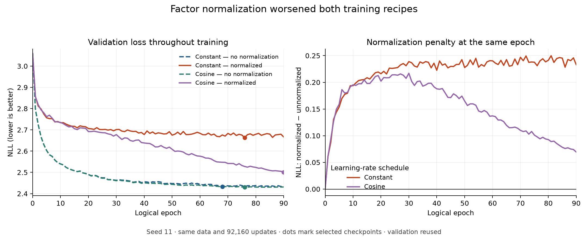

# Controlling redundant Hamiltonian factor scale

13 November 2026: declared before fitting. Results retrieved and audited 15 November 2026; see the completed analysis below.

[Locked diagnostics](hamiltonian-diagnostics.md) found 17–21× growth in raw QR
factor-column norms, despite unchanged predictions under positive column
rescaling. This suggests testing optimization with bounded factor scale. The
observed coordinate drift does not prove that Adam is defective or that removing
it improves learning. This study changes optimization without adding parameters,
classical features or a vocabulary head.

## Exact algorithm

Add opt-in `--factor-norm 1.4142135623730951` (sqrt(2)), disabled by default.
For each complex factor column F, divide by its Euclidean norm and multiply by
the declared target. Apply this once after model initialization, before initial
validation/optimizer construction, and immediately after **every Adam update**,
including the final partial batch. The update order is forward, loss, backward,
global gradient clipping at 5, Adam step, positive column normalization.

Do **not** reset, rescale or transport Adam's first/second moments. They retain
their numerical values after the projection. This fully specifies a constrained
optimization recipe; it is not an equivalent continuation of unconstrained Adam.
Energy parameters and every controller remain unchanged by normalization. The
QR basis defines the same physical evolution before and after each normalization,
but subsequent gradients, clipping and optimizer trajectories can differ.

Only models with trainable spectral factors accept this option; classical models
and frozen spectral cores reject it. Reject nonfinite/nonpositive targets and
zero/nonfinite columns. Default training has no normalization or new norm-history
fields. The chosen target is stored in training metadata; enabled runs record
minimum, mean and maximum raw column norms at every validation checkpoint.

## Fixed comparison

All three fresh fits use `prior_content`, three stages, rank 128, auxiliary size 2,
recent window 16, phase scale 1, and **1,073,900 trainable parameters**. Seed 11,
90 logical epochs, batch 512, NLL loss/selection and float64/complex128 match the
completed longer-budget study. No older-context dropout, optimizer resume,
classical output head, temperature adjustment or rejection.

| Fit | Factor normalization | Learning-rate schedule |
|---|---|---|
| norm_constant | sqrt(2) initially and after every step | Constant .003 |
| norm_cosine | sqrt(2) initially and after every step | Cosine .003 → .0003 over 90 epochs |
| cosine | Disabled | Cosine .003 → .0003 over 90 epochs |

The archived **unnormalized constant-rate** three-stage 90-epoch fit (NLL 2.43218)
is the corresponding constant-rate control. Its CUDA backend/data/inference are
unchanged. Default numerical behavior is checked against independent Adam steps;
archived source/weights are preserved and reference predictions reproduced. The
new cosine control tests this schedule on the current representation/data, where
prior cosine evidence from an older model cannot be assumed to transfer.

Also pin the four-stage quantum candidate (2.40905 NLL, 1,352,802 parameters),
strong adaptive MLP (2.17231, 750,460 parameters) and matched prior-feature MLP
(2.16622, 1,352,364 parameters), all at the same 90-epoch exposure budget. These
are outcome benchmarks with different architectures/parameter counts, not matched
normalization interventions. Archived MLP samples remain available; do not resample
or retune references. Their NLL difference was not statistically established.

Use the unchanged expanded full dataset, SHA256
`37349f5fe9a3442bdcd5cea6c4e660015f237995c805ab96fd52b5c5a06d4c28`.
Each epoch takes a fresh 524,288-row permutation prefix from 2,097,152 positions:
**92,160 updates and 47,185,920 row exposures** per fit, identical across fits.
Preserve train-only vocabulary/counts, 512-token byte BPE, 128-token causal context,
article partitions, UNK policy and 4,096 validation targets. No data preparation or
held-out-test predictions. The existing short NPZ is hash-checked for unchanged
partition/context integrity only; no new short model is fit in this screen.

## Selection and decision rules

Evaluate epoch zero and all 90 endpoints. Select each fit by validation NLL,
then greater sampling success, then earlier epoch, and lock weights before
validation reproduction and sample generation. Report final and selected epochs.

Declare two independent exploratory decisions:

- `norm_constant` must beat the archived constant-rate control with a paired
  article NLL interval wholly below zero and lower non-space NLL.
- `norm_cosine` must beat the new unnormalized cosine control by the same criteria.

A lower raw score than another schedule does not establish a normalization effect.
Report both rules even if only one passes. Identify the lower-NLL normalized
candidate for descriptive reporting (exact ties prefer `norm_constant`); that
choice does not override either rule. Compare both candidates against all other
fits/references/baselines, plus unnormalized cosine against archived constant.
Keep sampling S, argmax, NLL and non-space outcomes separate. No matched short
refit is included, so this screen cannot establish a normalization-specific
long-context benefit.

Use 2,000 article-bootstrap draws with seed 161803. This is a single-seed,
reused-validation screen with two normalized candidates; intervals omit selection
and training uncertainty. A positive result requires replication and independent
confirmation. It does not establish coherent generation or quantum advantage.

Save ten metric rows, 20 target buckets, 55 paired intervals and 15 unfiltered
64-token continuations (three new fits, bigram, unigram). Use the established
three prompts and seeds 20261030–20261032; preserve raw IDs, malformed UTF-8 and
control characters. Arrays/weights are NPZ, histories/tables CSV, metadata small
JSON. Do not change default training or adopt a candidate on diagnostics alone.

## Validation, execution and audit

Local tests cover nontrivial forward/gradient invariance under column scaling,
no-op default behavior, invalid targets/unsupported models, and independently
computed multi-step Adam trajectories with unchanged moments, including a partial
batch, history norms, selected checkpoint weights and metadata. The same numerical
checks are parametrized for CPU and CUDA. Local suite: **110 passed, 48 CUDA skips**;
Ruff and strict Pyright pass. Two reporting tests prevent selecting a low-NLL
recipe from bypassing its own control or hiding non-space regression.

Run in isolated `~/quantum-semantics-factor-norm-20261113`, prod10, one
`nvidia_a100_1g.10gb` slice, four CPU support threads, eight-hour ceiling. Planning
estimate about five to six hours, based on the original three-stage fit and small
normalization overhead; verify actual throughput before training. Run the full
158-test suite and both reporting tests on the DGX. Three real CUDA gates check
model/buffer/data placement, finite gradients, changed predictions, nonzero content
selector gradients, initial prior identity, normalized factor columns after updates,
full-pool residency, memory and synchronized throughput. Require peak reservation
below 80% of slice memory and summed projected optimizer time below six hours.

Pin source, dependencies, tools, data and all four references. Training/CLI are
the only inference-source hash exceptions for old references; preserve original
hashes and explicitly account for the new default-null metadata field. On completion,
verify all 91-row histories, row-exposure traces, schedules and norm summaries;
check saved factor-column norms and selection locks. Reload selected weights on
CUDA and reproduce all saved validation arrays. Independently audit tables,
baselines, intervals, both rules and sample decoding. Accept only Slurm COMPLETED
0:0 with verified input/output hashes; no training retry based merely on observer loss.

Generated tools/artifacts: `output/factor-norm/`. Submit once with
`bash output/factor-norm/submit.sh`; run local `bash -ic 'dgx start'`, verify actual
CUDA training, then stop during the experiment wait under the user's standing
instruction. Do not use codex-long-jobs. After completion,
`bash output/factor-norm/retrieve.sh` retrieves/audits without resubmitting.

## Verified startup — 13 November 2026

Slurm **11353** is RUNNING on the declared prod10 A100 1g.10gb slice. All **158
project tests** and both reporting tests passed, followed by three full-size CUDA
learning/resource gates. Both normalized gates retain factor-column norms within
1e-12 of sqrt(2); the unnormalized cosine control retains its distinct raw scales.
Parameters, data, forwards, gradients and actual parameter updates execute on CUDA.
All 135 pinned input hashes verify remotely after startup.

Peak reserved GPU memory is **2.578 GiB**, including the full resident training
pool and a checkpoint copy. Nine timing blocks project **4.856 hours** of optimizer
work across the three fits, below the six-hour guard. The first `norm_constant`
run metadata records CUDA and the declared factor target, and its training process
was confirmed live. The local `dgx start` notifier is active (PID 21809 when checked).

Goal work pauses under the user's standing instruction while this existing Slurm
job continues. No predictive result is available yet. On completion, inspect
11353 and retrieve/audit its existing artifacts; do not submit another job merely
because local observation ended.

## Completed results — audited 15 November 2026

**The normalization hypothesis fails under both tested schedules. Keep factor
normalization disabled.** The lower-NLL normalized variant is still worse than
its matching unnormalized control; it is not a successful candidate.

Slurm **11353 completed with exit 0:0 in 04:59:39**. Retrieval verifies all 135
pinned inputs and every output checksum, three locked fits, four archived
references, all 91-row histories, exact exposure schedules and selected weights.
The independent audit reproduces ten metric rows, 20 target buckets, 55 paired
intervals, both decision rules and all 15 sample renderings. The logs confirm
158 project tests, two reporting tests and three actual CUDA/norm/resource gates.
Selected weights were reloaded on CUDA and their saved validation arrays
reproduced. No restart or held-out-test scoring occurred.

| Recipe | Selected epoch | Selected NLL ↓ | Final NLL ↓ | Sampling S ↑ | Argmax ↑ |
|---|---:|---:|---:|---:|---:|
| Constant, normalized | 76 | **2.663669** | 2.666496 | 26.207% | 41.675% |
| Constant, unnormalized reference | 68 | **2.432182** | 2.433464 | 29.205% | 45.142% |
| Cosine, normalized | 90 | **2.500690** | 2.500690 | 28.347% | 44.067% |
| Cosine, unnormalized | 76 | **2.429852** | 2.431264 | 29.236% | 45.142% |

### The matching controls give a consistent negative answer

For constant learning rate, normalization increases NLL by **+.231488**, with
conditional 95% article interval **[+.211288, +.249214]**. Sampling falls **2.998
percentage points** [−3.271, −2.722], and argmax falls **3.467 points**
[−4.156, −2.782]. Non-space NLL worsens from **3.31743 to 3.62562** and non-space
sampling falls from **9.414% to 6.403%**.

For cosine decay, normalization increases NLL by **+.070838**, interval
**[+.058603, +.081884]**. Sampling falls **.889 points** [−1.030, −.732], and argmax
falls **1.074 points** [−1.842, −.370]. Non-space NLL worsens from **3.31201 to
3.40816**, and non-space sampling falls from **9.533% to 8.451%**. Both declared
normalization rules therefore fail on overall and non-space prediction.

Cosine helps within the normalized pair: NLL improves by −.162979
[−.179989, −.146191] versus normalized constant. That mitigates part of the harm
but does not demonstrate a normalization benefit. The metadata's
`selected_normalized_recipe: norm_cosine` only identifies the better of two
unsuccessful normalized recipes.

Without normalization, cosine minus constant NLL is **−.002330**, interval
**[−.008788, +.004162]**. Its sampling difference is +.031 points with an interval
crossing zero; selected argmax is identical. There is no established schedule gain
that warrants replacing the existing constant-rate reference.

### The mechanism worked; prediction did not improve

Every recorded norm extremum/mean in both normalized histories is within
**4.45e-16 of sqrt(2)**, and selected weight arrays satisfy the same constraint.
The model/data/device/budget checks and unchanged initial bigram predictions pass.
This is a negative scientific result, not failed execution or an unenforced option.

Selected training-pool NLL is also worse: **2.66500 normalized versus 2.40298
unnormalized** for constant rate, and **2.47952 versus 2.39533** for cosine. The
regression is therefore not confined to held-out validation or explained simply
by greater overfitting. The learning curves show an early penalty; cosine reduces
it later, while normalized constant remains substantially behind.

The right panel compares models at the same epoch; the decision intervals above
compare their separately locked selected checkpoints. These answer different
questions and should not be interchanged. Normalized cosine still selects its
final epoch, so the result is specifically about the declared 90-epoch budget.
No budget extension is made after seeing this result.

The earlier diagnostic remains valid: positive raw-column scaling is redundant
for QR-based inference, and raw norms grew substantially during training. However,
preserving the immediate forward function does not preserve the optimizer
trajectory. The tested initial/after-step projection, with unchanged Adam moments,
clipping and declared rates, materially worsens learning. Scale growth by itself
was not sufficient evidence that removing it would help. This does not establish
that all possible normalization algorithms are harmful, nor identify a unique
cause within the tested optimization recipe.

These are single-seed results on repeatedly used validation. Article intervals
condition on the observed training runs and omit training/selection uncertainty.
The large consistent penalties justify declining adoption of this tested recipe;
they are not independent confirmation or a universal claim about quantum training.

### Generation, costs and stopping state

All nine new quantum continuations remain incoherent. The normalized-constant
third sample has one UTF-8 replacement character. The normalized-cosine first
sample has one non-whitespace control character (U+0018). The unnormalized-cosine
samples have neither issue, but still do not form coherent prose. All outcomes
are preserved without rejection or repair; three samples per recipe are diagnostics,
not a reliable estimate of malformed-text frequency or overall language quality.

Fit times are **98.375 minutes** normalized constant, **98.349 minutes** normalized
cosine and **97.786 minutes** unnormalized cosine. All use the complete resident
training pool (2,164,260,864 bytes); startup-gate peak reserved memory is
**2.578 GiB**. Nine
synchronized timing blocks, actual CUDA learning and memory/time guards verify.
Normalization did not create a material runtime saving in these observed fits;
these timings are not a controlled performance benchmark or quantum speedup claim.

The earlier larger quantum candidate remains at **2.40905 NLL**, while the
classical references remain substantially stronger at **2.17231 and 2.16622**.
This study does not close that gap, establish useful long-form text generation or
change the evidence level of earlier single-seed/replicated results. Retain the
normalization code as an opt-in reproducibility feature, with its default disabled.

**Experiments are paused at the user's request.** This completes retrieval and
analysis of the current idea. The queue was empty on inspection; no further fit,
new experiment plan or test score was initiated. Preserve the raw runs and compact
results for later reference. Nothing in this analysis requires an experiment to
remain running during the pause.

Compact evidence: [metrics](factor-norm-validation.csv),
[paired intervals](factor-norm-paired.csv), [target buckets](factor-norm-target-buckets.csv),
[raw samples](factor-norm-samples.csv), [sample diagnostics](factor-norm-sample-diagnostics.csv),
[resources](factor-norm-resources.csv), and [timings](factor-norm-timings.csv).
