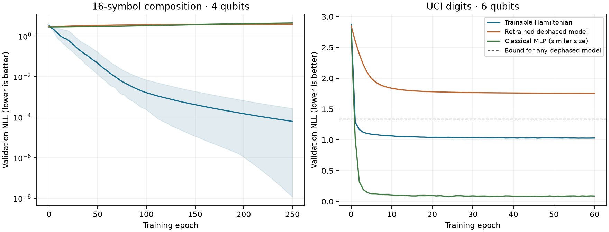

# Learning in the Hamiltonian with fixed encoding and Born measurement

**Result, 26 October 2026:** Hamiltonian-only training improves held-out prediction
with no learned classical encoder or decoder. Five fresh seeds solve unseen symbolic
combinations perfectly and reach **91.96% digit accuracy**. Preserving coherence improves
likelihood over the entire dephased architecture, including its theoretical optimum.
The digit classical MLP is stronger overall; these experiments establish trainability
and a useful role for coherence, with no computational-speedup or language-model claim.

| Held-out task | Hamiltonian coefficients | Frozen initial accuracy | Trained accuracy | Retrained dephased accuracy |
|---|---:|---:|---:|---:|
| 16-symbol composition, 4 qubits | 256 | 11.67% | **100.00%** | 8.33% |
| UCI digits, 6 qubits | 4,096 | 5.84% | **91.96%** | 61.88% |

All scores average seeds 47–51 on one fixed held-out split. Frozen initial scores use
the exact same initial H as the corresponding trained run. The 80 fits completed in
**27.664 seconds** with eight one-thread CPU workers on the local Ryzen 7 7840S;
download, pilots and validation checks are outside that timing.



Curves are validation NLL means, shaded by the min–max across five seeds. The symbolic
panel uses a logarithmic axis. The dashed digit line is the theoretical lower bound
for every dephased model with this fixed readout, derived below; it does not constrain
the coherent model or classical MLP. Checkpoints were selected by validation NLL.

## Question and scope

This experiment asks whether training a Hamiltonian can improve unseen predictions
when **there is no learned classical encoder, controller or decoder**. It replaces
the latent hybrid architecture rather than extending it. A separate, retrained
dephased model tests whether usable coherence matters within the chosen architecture.
Classical predictors are retained to distinguish those questions from superiority
over classical machine learning.

The experiment is exploratory: small validation pilots informed the model and budgets.
The executable writes its protocol before training, locks learning rates before fresh
seed fits, and locks every selected checkpoint before scoring the test sets. All model
families and confirmation seeds are evaluated. No architecture is selected on test.

## A task with a provable coherence requirement

The inputs are two symbols `a,b` in a vocabulary of 16, with target `(a+b) mod 16`.
Four qubits represent the 16 symbols directly. This is symbolic composition, not natural
language. Targets come from the arithmetic rule, not a randomly generated quantum teacher.

Start in the fixed basis state `|a>`. Let `U = exp(-i H_theta)` and apply

\[
 |\psi(a,b)\rangle=U^\dagger D_b U|a\rangle,\qquad
 D_b[k,k]=e^{2\pi i kb/16},\qquad
 p(y|a,b)=|\langle y|\psi(a,b)\rangle|^2.
\]

`D_b` is a fixed input phase operation. Only the **256 real coordinates of the Hermitian
16×16 Hamiltonian** learn. The same Hamiltonian is reused with opposite evolution times;
there is no output softmax, learned calibration, prior, ancilla or postselection. An
identity component of H gives an unobservable global phase, so the effective parameter
dimension is at most 255. Other task-specific symmetries can cause further redundancy.

An explicit solution is the positive-sign discrete Fourier matrix
`U[k,a] = exp(2 pi i k a/16)/4`. Then `U† D_b U |a> = |(a+b) mod 16>` exactly.
Every unitary has a Hermitian logarithm, so this solution is in the model family;
training does not receive it. An independent test verifies all 256 combinations.

If the intermediate state is completely dephased **before D_b**, that phase operation
cannot change its diagonal density matrix. Predictions become independent of b for
every possible learned H. With uniform independent symbols, every b-blind model has
population accuracy at most **1/16** and NLL at least **ln(16)**. Thus there is a genuine
expressivity separation from this dephased architecture. It is not a separation from
unrestricted classical algorithms: classical modular addition also solves the task exactly.

Split seed 314159 selects, for each a, ten b values for training, three for validation
and three for test: **160 / 48 / 48 distinct contexts**. Test combinations are unseen,
while their individual symbols have appeared during training. Finite split scores for
the b-blind control need not equal its full-population 6.25% bound.

## Independent real data: handwritten digits

The [UCI Optical Recognition of Handwritten Digits dataset](https://archive.ics.uci.edu/dataset/80/optical+recognition+of+handwritten+digits)
contains 64 pixel-count features and ten classes. Its official training and test sets
come from different writers. The downloaded archive stays in ignored outputs; SHA-256
digests of the archive, both source files, and all prepared arrays are saved in each run.
The official test split stays intact. Within the official training file, fixed seed
271828 selects about 20% of exact-image groups per class for validation. Exact images
cannot cross any split; preparation fails if official train/test images overlap.

An image is loaded as the **fixed** amplitude state

\[
 |x\rangle=\sum_{k=0}^{63}\frac{x_k}{\|x\|_2}|k\rangle.
\]

Six qubits evolve under `U_theta = exp(-i H_theta)`. Measure the four leading qubits:

\[
 p(y|x)=\sum_{r=0}^3|\langle 4y+r|U_\theta|x\rangle|^2,
 \quad y=0,\ldots,15.
\]

All **4,096 real trainable coefficients belong to H**. The fixed measurement has sixteen
outcomes: unused labels 10–15 retain their probability and count as errors. Summing over
the other two qubits is a partial trace, not successful-outcome conditioning. There is
no classical feature learner or trainable decoder. Pixel normalization is the only input
preprocessing, and classical controls receive the same normalized pixels.

The equally parameterized dephased control is retrained from the same initial H after
replacing `|x><x|` by `diag(|x|²)`. Its predictions can only combine input pixel powers;
the coherent model additionally uses cross terms between amplitudes. This removes
off-diagonal input information, rather than testing a generic classical algorithm.

### A bound that rules out insufficient control training as the explanation

For a completely dephased input, the density matrix eigenvalues are `v_k = x_k²/||x||²`.
Each label measurement is a rank-four projector, even after conjugation by an arbitrary
learned unitary. Write its diagonal entries as `w_k`: they lie in [0,1] and sum to four.
Then `p(y|x) = sum_k v_k w_k` is at most the sum of the **four largest v_k**. Consequently,
every dephased model in this family, with any H and any amount of training, satisfies

\[
 \operatorname{NLL}_{\rm dephased}\geq
 -\frac1N\sum_x\log\left(\sum_{k\in\operatorname{top4}(v(x))}v_k(x)\right).
\]

The bound is **1.33007555 on the official test images** (1.33868818 on validation).
All five coherent test NLLs, **1.04487–1.05019**, are below it. Their mean is **1.04751**.
This establishes a likelihood separation from the entire dephased family; a better
optimizer for that family cannot close this gap. It does not bound its top-1 accuracy,
and does not constrain classical networks that recompute nonlinear features from pixels.
The bound was derived after viewing the completed test results, then checked using saved
input arrays and predictions. It was not used to select or retrain any model.

Both models have a direct classical density-matrix/simulator implementation. The coherent
classifier is a constrained quadratic classifier, so success does not demonstrate
computational advantage. A shared unitary preserves input fidelity while learning a
useful measurement basis; changing the fidelity geometry is not necessary here.

## Comparisons, optimization and selection

Both tasks compare coherent H, separately trained dephased H, linear softmax, a roughly
parameter-matched tanh MLP, and a larger tanh MLP. The modular MLP inputs are the two
one-hot symbols; its hidden widths are 5 and 32, giving 261 and 1,584 parameters.
Digit MLP widths are 50 and 256, giving 4,066 and 20,752 parameters. Linear controls have
528 and 1,040 parameters. The modular circuit's phase operation contains a relevant
algebraic inductive bias that these generic networks do not share.

All models use Adam, no weight decay, clipping norm 5 and float64/complex128 arithmetic.
One epoch visits every training example exactly once, keeping the final partial batch.
Modular fits use 250 epochs and batch size 160; digit fits use 60 epochs and batch size 256.
For each model/task, seed 11 screens three learning rates. The modular quantum grid is
0.01/0.03/0.1; all other grids are 0.003/0.01/0.03. Minimum validation NLL, including
epoch zero, selects a learning rate. It is locked before confirmation seeds **47–51**.
The same validation rule selects each confirmation checkpoint. All 50 confirmation
checkpoints are locked before test evaluation. Coherent/dephased initial tensors and
training-example orders are paired within each seed; each control learns independently.

The 30 screen and 50 confirmation fits are exact CPU simulations. Normalization is
checked without renormalizing outputs; a 1e-15 log floor only prevents numerical log(0).
Bootstrap intervals, where reported, resample paired test examples after averaging seed
differences. They are conditional on this split; digit writer IDs are unavailable and
example resampling cannot represent writer-level uncertainty.

## Complete held-out comparisons

| Symbolic model | Parameters | Test NLL | Test accuracy |
|---|---:|---:|---:|
| Trained coherent Hamiltonian | 256 | **0.000059** | **100.00%** |
| Retrained dephased Hamiltonian | 256 | 2.8049 | 8.33% |
| Linear softmax | 528 | 2.7962 | 6.67% |
| Tanh MLP, width 5 | 261 | 2.8134 | 5.42% |
| Tanh MLP, width 32 | 1,584 | 2.7783 | 6.67% |
| Exact classical modular addition | 0 | 0 | 100.00% |

The last row is the exact arithmetic rule, not a fitted model. Generic classical
networks select epoch zero: fitting observed symbol pairs does not teach the held-out
composition rule under these encodings. The circuit's Fourier-compatible phase input
provides that inductive bias. This is a controlled existence result, not a claim that
classical learning cannot be given the same algebraic structure.

| Digit model | Parameters | Test NLL, mean ± seed SD | Test accuracy, mean ± seed SD |
|---|---:|---:|---:|
| Trained coherent Hamiltonian | 4,096 | **1.0475 ± 0.0023** | **91.96% ± 0.41 pp** |
| Retrained dephased Hamiltonian | 4,096 | 1.7683 ± 0.0008 | 61.88% ± 1.77 pp |
| Linear softmax | 1,040 | 0.1904 ± 0.0008 | 94.31% ± 0.05 pp |
| Tanh MLP, width 50 | 4,066 | 0.1821 ± 0.0181 | 95.43% ± 0.14 pp |
| Tanh MLP, width 256 | 20,752 | 0.1763 ± 0.0083 | 94.86% ± 0.05 pp |

Initial coherent digit NLL is 2.9122. The selected digit H checkpoints are epochs
57/51/59/52/44. The dephased control selects 60/60/60/59/60: its finite-budget fit might
still improve, but even its analytic best-case bound is worse than the trained coherent
likelihood. The coherent-minus-dephased mean NLL difference is **−0.72080**, with a paired
example-bootstrap 95% interval **[−0.73217, −0.70968]**, conditional on this split and fits.

Selected learning rates, locked on seed 11:

| Task | Coherent | Dephased | Linear | Small MLP | Larger MLP |
|---|---:|---:|---:|---:|---:|
| Symbols | 0.1 | 0.1 | 0.003 | 0.003 | 0.003 |
| Digits | 0.01 | 0.003 | 0.03 | 0.03 | 0.01 |

## What this changes for the project

The Hamiltonian can have a useful trainable role without a learned classical head.
Here the learned mixing amplitudes and phases perform the classification, and complete
dephasing creates a provable limitation. The sufficient conditions are an input encoding
whose useful distinctions can survive to measurement, an expressive trainable H, and a
task compatible with its constrained Born probabilities. Learning only global times for
a frozen corpus graph is a much narrower model family.

The subsequent [language follow-up](LANGUAGE_BORN.md) tests this principle on real
next-word prediction, with improvements from H training and coherence relative to
retrained dephasing; its classical MLP and bigram remain stronger. Symbol composition
and digit recognition remain separate tasks and do not repair the old directed
bigram model. Dense d×d matrix exponentials and
d² learned coordinates are deliberately small here; the 4-/6-qubit timings do not imply
feasible dense training near 20 qubits. State preparation, gate compilation, shot-based
gradients and hardware noise are outside the experiment. Structured Hamiltonian
couplings remain a possible extension, with frozen, dephased and tuned classical controls.

## Reproduction

```bash
mkdir -p outputs/born-evidence-data
curl -fL 'https://archive.ics.uci.edu/static/public/80/optical+recognition+of+handwritten+digits.zip' \
  -o outputs/born-evidence-data/optdigits.zip
OMP_NUM_THREADS=1 OPENBLAS_NUM_THREADS=1 MKL_NUM_THREADS=1 \
uv run python -m experiments.hamiltonian_study.born_evidence \
  --digits-archive outputs/born-evidence-data/optdigits.zip --workers 8
```

Every invocation creates a unique directory with executed source, dependency lock,
source/data/weight hashes, full validation histories, recipe and checkpoint selection
locks, inference weights, test probabilities and compact summaries. Checkpoints do not
support optimizer resume. The test evaluator requires a lock and rejects a second
evaluation when saved test results exist. Raw downloaded/generated artifacts stay out of Git.

Completed run: `outputs/born-evidence/fixed-encoding-20261025T233448Z-q_806f9r/`.
Selection-lock SHA-256: `24e2a0fa8685324e4cd33119ff7fcd998acb6f297854e524534f4b1aff2f516d`.
The source/archive/split hashes are in `protocol.json` and `data.json`; `analysis.json`
audits all 50 confirmation checkpoints and saved test metrics, and records the post-hoc
bound. Rebuild the audit and figure without fitting or rerunning test inference:

```bash
uv run python -m experiments.hamiltonian_study.analyze_born \
  outputs/born-evidence/fixed-encoding-20261025T233448Z-q_806f9r \
  --figure outputs/born-evidence/fixed-encoding-20261025T233448Z-q_806f9r/learning.png
```

The theory of encoding-dependent expressivity motivates choosing a task whose information
can survive to measurement; see [Schuld, Sweke and Meyer (2021)](https://arxiv.org/abs/2008.08605).
The specific modular construction and its dephasing bound above are direct derivations,
not experimental claims from that paper.
