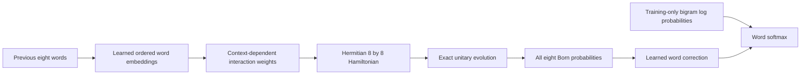

# Hybrid context-correction proof of concept

23 October 2026 · CPU proof of concept · three seeds · validation only

**Attribution limit:** this is a learned classical context encoder/controller,
a latent Hamiltonian feature map and a learned classical word head. The free
weights reside in the classical modules (12,600 encoder/controller and 4,608
head parameters); the eight Hermitian generators are fixed and their context
coefficients are neural-network outputs. End-to-end improvement does not
establish that the Hamiltonian supplies useful computation. The matched
classical replacement has lower tuned NLL. No frozen-controller or fixed-head
study has isolated the source of the original network's gains.

This is an architectural departure from the intended vocabulary-space model
with one basis state per word and direct Born word probabilities. It should
not be scaled as evidence that the original model's training problem is solved.

**Training improves the hybrid model on the existing Tatoeba data.**
Validation NLL falls from **2.9493 to 2.8050** and next-word accuracy rises from
**32.91% to 35.56%**, averaged over three seeds. A classical context correction
also improves. The last-word-only control selects its untrained baseline in
all three runs. This supports learning a correction from earlier context.
It does not establish a benefit specific to quantum computation.

The subsequent matched search below gives the classical control the lower NLL,
with nearly tied accuracy. The initial small Hamiltonian lead depended on the
shared fixed recipe and does not survive this tuning comparison on primary NLL.

## Matched tuning follow-up

The staged CPU search completed **30 fits in 250.98 seconds (4m11s)**, using
16 workers with one numerical thread each on the Ryzen 7 7840S (8 physical /
16 logical cores). It used exactly the same 32,768 training and 4,096 validation
targets as the original POC; fingerprints and paired initial tensors match.

The prespecified grid was learning rate **0.001 / 0.003 / 0.01** and weight decay
**0 / 0.001 / 0.01**. Each model received nine seed-11 screening fits of 60 epochs.
Its two lowest-validation-NLL recipes were then locked before 12 additional fits
using **fresh seeds 47/48/49**. Every fit had the same 15,360 updates, initial
bigram, model dimensions and validation schedule. The test set remained unused.
Epoch zero was eligible. Recipe and checkpoint selection used NLL throughout.

Both models' best recipe by fresh-seed mean NLL was **LR 0.01, decay 0.01**:

| Model | Mean validation NLL ± seed SD | Top-1 | Top-5 | Selected epochs |
| --- | ---: | ---: | ---: | --- |
| Fixed bigram | 2.94933 | 32.91% | 60.38% | — |
| Hamiltonian, LR 0.01 / decay 0.01 | 2.79402 ± 0.00476 | 36.17% | 63.53% | 9, 12, 9 |
| Classical, LR 0.01 / decay 0.01 | 2.78157 ± 0.00308 | 36.03% | 63.88% | 17, 16, 13 |
| Hamiltonian alternative, decay 0 | 2.79764 ± 0.00337 | 36.38% | 63.75% | 9, 9, 10 |
| Classical alternative, decay 0.001 | 2.78931 ± 0.00267 | 36.00% | 63.80% | 15, 14, 11 |

At the NLL-selected recipes, classical NLL is lower by **0.01246**. Hamiltonian
top-1 is higher by **0.1465 percentage points**. Each direction holds in all
three paired seeds, but these small differences have no fresh-population
confirmation or selection-adjusted interval. Selecting the alternative
Hamiltonian recipe for its higher accuracy would change the primary endpoint.
Known-target NLL also favors classical: 2.91327 versus 2.92454.

The screen's best validation NLL by recipe was:

| LR | Decay | Hamiltonian | Classical |
| ---: | ---: | ---: | ---: |
| 0.001 | 0 | 2.81726 | 2.83421 |
| 0.001 | 0.001 | 2.81705 | 2.83392 |
| 0.001 | 0.01 | 2.81529 | 2.83106 |
| 0.003 | 0 | 2.80645 | 2.82087 |
| 0.003 | 0.001 | 2.80847 | 2.82432 |
| 0.003 | 0.01 | 2.80467 | 2.81927 |
| 0.01 | 0 | 2.80186 | 2.80799 |
| 0.01 | 0.001 | 2.80566 | 2.80189 |
| 0.01 | 0.01 | 2.80231 | 2.78614 |

Larger learning rates within this grid help both models; the classical model
benefits more. Stronger tested regularization helps the selected classical
recipe. Training duration interacts with LR: low-LR screen optima occurred
around epochs 31–47, while the chosen faster recipes peaked much earlier.
Running all the way to 60 generally worsened validation loss. The useful
checkpoint ranges for the selected recipes were **9–12 epochs Hamiltonian**
and **13–17 epochs classical**.

These are **best tested settings**, not an established optimum. Both selected
LR and decay hit the upper grid boundaries, so a wider range could still help.
Fresh seeds provide information about initialization variability, while this
reused validation set remains part of recipe/checkpoint selection.

Reproduce the complete staged search:

```bash
OMP_NUM_THREADS=1 OPENBLAS_NUM_THREADS=1 MKL_NUM_THREADS=1 \
uv run python -m experiments.hamiltonian_study.tune_contextual \
  --dataset experiments/hamiltonian_study/results/tatoeba_full_data \
  --train-limit 32768 --validation-limit 4096 --epochs 60 --batch-size 128 \
  --lrs 0.001 0.003 0.01 --decays 0 0.001 0.01 --screen-seed 11 \
  --confirmation-seeds 47 48 49 --keep 2 --workers 16 --threads 1
```

Use the preparation command below if the ignored full-data arrays are absent.
The isolated tuning runner creates a unique directory, freezes source/data
fingerprints before fitting and writes a selection lock before submitting fresh
seeds. Every confirmation result records that lock's SHA-256. There is no
optimizer-resume support. The completed local study is:

```
outputs/contextual-tuning/paired-search-20261023T071728Z-0w2vlf8d/
```

Independent review verifies 18 screen + 12 confirmation records, all 60-epoch
histories, selected checkpoint minima, optimizer settings, source snapshot
hashes, selection-lock hashes and exact data/initial-weight parity with the
original POC. Its shared-recipe first 12 epochs reproduce the original NLL
trajectory exactly. Raw curves, inference weights and source snapshots remain
ignored; this report retains the conclusions and compact tables.

## What changed

The previous directional graph was a fixed transformation of the bigram table,
with 33 global scalars and rare destination-role conditioning. This prototype
uses a **small latent Hamiltonian**, with learned word embeddings and ordered
context controlling its interactions. It is a new model, separate from the
512-word graph walk. Its latent basis indices do not denote words.



The model computes

```
a(c) = tanh(MLP(concatenated ordered word embeddings))
H(c) = sum_k a_k(c) G_k
f(c) = abs(exp(-i H(c)) |plus>)**2
logits(w|c) = log P_bigram(w|last) + W[w] @ f(c) + b[w]
```

There are eight fixed Hermitian generators. One is a diagonal role potential;
the others couple four latent source states to four latent destination states
through general complex matrices and their adjoints. Their construction is
independent of word IDs and uses a fixed seed. The **coefficients**, word
embeddings, context network and word head learn. These latent generators are
not presented as a learned semantic word graph.

The state has eight amplitudes, equivalent to three qubits, initially uniform
over the full register. All eight measurement outcomes feed the word head;
there is no destination-role postselection. The head starts at zero, giving
exactly the bigram prediction at epoch zero. No earlier-context bypass reaches
the head: its context-dependent input is the Hamiltonian feature vector.

This is exact classical matrix-exponential simulation. An eight-dimensional
state is inexpensive to simulate; no hardware or speedup result is claimed.

## Controls and fixed recipe

All three learned models have **17,208 parameters**, with byte-identical initial
trainable tensors within each seed. They share a 16-dimensional token lookup,
ordered eight-slot context, hidden width 32, eight features and the same word
head/bigram offset. Padding has a separate zero embedding and is not an output.

| Model | Feature map and available context |
| --- | --- |
| Hamiltonian | Full Born vector from the context-conditioned unitary. |
| Classical context | Softmax of the same eight context coefficients. |
| Last-word-only | Same classical model, with earlier slots padded during both training and evaluation. |

The classical feature map has the same output dimension, simplex range and
parameter count. Its functional form differs; this does not prove equality of
expressive power or equal optimal tuning. The last-word model has the same
allocated parameter count but fewer active input positions.

The experiment uses the existing sentence-grouped Tatoeba split, training-only
512-word vocabulary (including UNK), and training-only bigram statistics from
1,162,743 transitions. A fixed seeded sample of **32,768 training targets** is
drawn without replacement from the complete eligible training split. All models
use exactly these targets and the same **4,096 validation targets**. Groups are
disjoint. The saved test arrays are never loaded or scored.

Seeds: **11, 22, 33**. Each fit resets weights and AdamW, with LR 0.003, weight
decay 0.001, batch size 128, clipping norm 5 and **12 complete sampled-pool
epochs** (3,072 updates). The final partial batch is retained when needed.
Each epoch evaluates the full validation subset; minimum validation NLL,
including epoch zero, selects the checkpoint. The recipe is shared, with no
architecture-specific tuning. This is not the old robust 100×20k protocol.

## Real-data results

Means across the three fitted seeds. Accuracy columns are percentages.

| Model | Validation NLL ↓ | Top-1 ↑ | Top-5 ↑ |
| --- | ---: | ---: | ---: |
| Fixed bigram / every model before training | 2.9493 | 32.91 | 60.38 |
| **Trained Hamiltonian context correction** | **2.8050** | **35.56** | **63.69** |
| Trained classical context correction | 2.8288 | 35.25 | 63.18 |
| Trained last-word-only correction, selected checkpoint | 2.9493 | 32.91 | 60.38 |

The Hamiltonian model improves NLL and top-1 over its initial state in every
seed. Excluding UNK targets, its accuracy rises from **28.96% to 32.28%** and
NLL falls from **3.0963 to 2.9348**; the result is not confined to unknown words.

| Seed | Hamiltonian NLL / top-1 | Classical NLL / top-1 | Selected epochs: H / C / last-word |
| --- | ---: | ---: | --- |
| 11 | 2.809562 / 35.5957% | 2.833958 / 34.8877% | 11 / 12 / 0 |
| 22 | 2.807874 / 35.9375% | 2.834893 / 35.3760% | 11 / 12 / 0 |
| 33 | 2.797707 / 35.1562% | 2.817601 / 35.4736% | 12 / 12 / 0 |

The Hamiltonian beats this classical control on NLL in all three seeds, but
top-1 changes sign in seed 33. The classical control selects epoch 12 in all
runs and may benefit from more training or tuning. No new seed, split, external
corpus or held-out-test confirmation has been done. These reused validation
results are exploratory, without confidence intervals or a quantum-advantage claim.

Learning reaches the Hamiltonian controller: at the second epoch's first batch
in seed 11, gradient norms were 0.00460 for the lookup and 0.02852 / 0.03182 for
the context-network weight matrices. Zero head initialization intentionally
blocks upstream gradients on the first update; they become nonzero after the
head starts learning. Gradients alone do not attribute the final gain to one
component; a frozen-controller ablation would be needed for that claim.

Recorded fit times total **28.99s Hamiltonian**, **10.36s classical**, and
**10.49s last-word** over three fits each, excluding common data loading and
packaging. They are local CPU measurements, not a DGX or hardware forecast.

## Controlled order task

An additional generated task has contexts `cueA cueB filler bridge`, with the
next word determined by the **first** cue. The last word is always `bridge`.
All 256 context/target sentences are distinct; 192 train and 64 validate on
unseen combinations of familiar words. This isolates a predictable benefit
from using earlier ordered context; it is not evidence of language understanding.

With three seeds, 60 epochs, batch 64 and LR 0.01:

| Model | Validation NLL | Top-1 |
| --- | ---: | ---: |
| Initial bigram | 1.4432 | 18.75% |
| Trained Hamiltonian | 0.3104 | 100% |
| Trained classical context | 0.4631 | 100% |
| Trained last-word-only | 1.4082 | 18.75% |

The finite split's bigram accuracy is below the population chance rate of 25%.
Both context models solve the task; success is not uniquely quantum.

## Reproduce and inspect

From the repository root, on CPU:

```bash
export OMP_NUM_THREADS=1 OPENBLAS_NUM_THREADS=1 MKL_NUM_THREADS=1
uv run python -m experiments.hamiltonian_study.contextual \
  --toy --epochs 60 --batch-size 64 --lr 0.01 --seeds 11 22 33

# Recreate the full eligible training pool if its ignored arrays are absent.
uv run python -m experiments.hamiltonian_study.run prepare \
  --data data/tatoeba.csv --dataset outputs/contextual-data \
  --vocabulary 512 --window 8 --train-limit 0 --val-limit 4096 --test-limit 8192
uv run python -m experiments.hamiltonian_study.contextual \
  --dataset outputs/contextual-data --train-limit 32768 --validation-limit 4096 \
  --epochs 12 --batch-size 128 --lr 0.003 --seeds 11 22 33
```

The measured real-data command used the already prepared
`experiments/hamiltonian_study/results/tatoeba_full_data` directory instead of
`outputs/contextual-data`. The runner creates unique output directories and
records the configuration/data/source hashes before fitting. It saves selected
inference weights, per-epoch curves, initial parameter hashes, selected training
and validation metrics, and the exact sampled contexts/targets/groups. It does
not provide optimizer resume or production-run compatibility.

Measured local directories, kept ignored:

```
outputs/contextual-hamiltonian/corpus-20261022T231427Z-_smskxea/
outputs/contextual-hamiltonian/toy-20261022T231427Z-1hqprx7z/
```

Both contain `summary.json`, `protocol.json`, `selection.npz`, selected `.pt`
states, and copied source/lock files with a provenance manifest. Supporting
source was copied after execution; the executed contextual source was checked
against the pretraining hash:
`43f9db54e15eb1720e30cfad9e53e6dabf8e2cbdf0f7b940d225a1e776ab69e8`.
Keep raw runs local; retain this report as the concise result.

Seven regression checks cover independent SciPy exponential/gradient agreement,
normalization without postselection, paired initial weights and exact bigram
initialization, gradients into the controller, learning on unseen toy contexts,
nontrivial last-word invariance, vocabulary relabeling and train/validation
group separation without accessing test arrays. The full suite passes
**265 tests with 46 hardware skips**. Ruff passes; repository-wide Pyright has
zero errors and the nine pre-existing optional PDF-import warnings.
