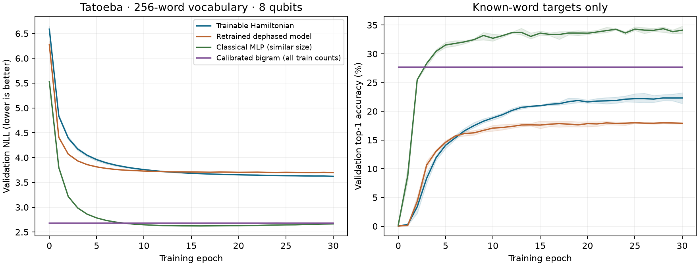

# Hamiltonian-only learning on causal word prediction

**Result, 26 October 2026:** the training gain transfers to natural-language next-word
prediction. Across three fresh seeds, a fixed-encoding/direct-Born Hamiltonian improves
held-out NLL **6.5861→3.5974** and exact word accuracy **2.57%→24.21%**. The separately
retrained dephased model has NLL 3.6683 / accuracy 19.51%. The paired coherent-minus-
dephased NLL interval is **[−0.0830, −0.0594]**, supporting a coherence contribution on
this split. A similarly sized classical MLP remains substantially stronger, at
**2.6205 NLL / 38.29% accuracy**; even a bigram using only the same 32,768 optimization
examples reaches 2.8837 NLL / 34.09%. This establishes useful Hamiltonian learning,
with no overall advantage over these classical language predictors.

**Readout clarification:** the headline accuracies above use argmax of exact simulated
probabilities. They are not the success probability of one physical measurement.
The post-hoc one-shot evaluation below uses the latter operational metric.

## One-shot word measurement: post-hoc evaluation

For a device that prepares the input, evolves it once, measures once and returns the
word assigned to that bitstring, ideal expected success is

\[
 S=\frac1N\sum_{i=1}^N p_\theta(y_i\mid C_i).
\]

No distribution reconstruction, argmax, temperature adjustment, rejected outcomes or
additional shots are part of this rule. Ideal simulator probabilities predict its
expectation; hardware noise and shot-based training remain untested.

Recomputed from the existing saved per-example NLL arrays, with no fitting or further
model inference:

| Predictor | One sample/shot: correct word | Argmax of its distribution |
|---|---:|---:|
| Frozen initial coherent H | 1.91% | 2.57% |
| Trained coherent H | **6.76%** | 24.21% |
| Retrained dephased H | 5.71% | 19.51% |
| Matched-input classical MLP | 24.77% | 38.29% |
| Bigram fitted on optimization subset | 18.95% | 34.09% |
| Plain bigram, all training counts | 19.90% | 34.46% |

The coherence comparison is **+1.050 percentage points** of one-shot success, with a
paired sentence-group 95% interval **[+0.988, +1.111] pp**. Known-target one-shot success
is 6.76% for coherent H and 22.36% for the classical MLP. The gain from H training and
the dephasing comparison persist, while strong classical models remain well ahead.

The classical sampling column is a distribution-to-distribution comparison. For a
word-guessing task, a classical predictor can instead return its cheap argmax; comparing
practical systems must permit that strategy and account for the quantum shots needed
to implement any alternative readout. The 24.21% quantum argmax figure assumes access
to the full simulated output distribution and is not available from one device shot.

The computation is `mean(exp(-individual_loss))`, not `exp(-mean_loss)`. The 1e-30 log
floor changes the recovered individual probability by at most 1e-30. Raw summaries are
in `one_shot_summary.json` in the completed run directory. Checkpoint/LR selection used
validation NLL, not this newly emphasized score; no selection is changed retrospectively.
Future experiments must declare their operational score, shot budget, training objective
and validation selection criterion before held-out evaluation.



Curves show validation means and min–max seed bands over all epochs, before checkpoint
selection. The right panel excludes UNK targets and keeps the original word probabilities.
The quantum model learns substantially but still has a large gap to the matched MLP.

## Held-out results

All scores use the same **8,192 targets from 7,225 held-out sentence groups**, averaged
over training seeds 61/62/63 where fitted. UNK targets are **16.98%** of this sample.
Accuracy is exact joint-word top-1; ± is sample SD across optimization seeds, in
percentage points for accuracy. The H's fixed encoder/readout have no learned parameters.

| Model | Learned parameters | Test NLL | Test top-1 | Known-target NLL | Known-target top-1 |
|---|---:|---:|---:|---:|---:|
| Frozen initial coherent H | 65,536 frozen | 6.5861 | 2.57% | 6.9162 | 0.12% |
| **Trained coherent H** | **65,536** | **3.5974 ± 0.0066** | **24.21% ± 0.16 pp** | **3.6558** | **22.49%** |
| Retrained dephased H | 65,536 | 3.6683 ± 0.0046 | 19.51% ± 0.09 pp | 3.7311 | 17.56% |
| Classical MLP, same encoded input | 64,852 | 2.6205 ± 0.0025 | 38.29% ± 0.43 pp | 2.8683 | 32.84% |
| Calibrated bigram, all training counts | 2 | 2.6867 ± 0.0001 | 34.46% | 2.9603 | 26.66% |
| Bigram, only optimization-subset counts | 0 gradient-trained | 2.8837 | 34.09% | 3.1935 | 26.41% |
| Plain bigram, all training counts | 0 gradient-trained | 2.6877 | 34.46% | 2.9613 | 26.66% |
| Directed classical context propagation | 0 gradient-trained | 3.1069 | 30.60% | 3.4324 | 21.01% |
| Unigram, all training counts | 0 gradient-trained | 4.2408 | 16.98% | 4.7420 | 0.00% |

Count-based models have fitted tables/preprocessing even when they have no gradient-
trained weights. The full-count references see 1,159,392 training transitions; the
subset bigram and MLP show that this additional statistical data does not explain
away the entire classical lead. Identity Born readout achieves 2.56% accuracy but
assigns structural zero probabilities to many targets; its numerically capped NLL
62.519 depends on the 1e-30 floor and is not a finite unsmoothed likelihood.

| Paired NLL difference | Mean | Sentence-group bootstrap 95% interval |
|---|---:|---:|
| Coherent trained − its frozen initialization | −2.98867 | [−3.03383, −2.94038] |
| Same training comparison, known targets only | −3.26038 | [−3.30813, −3.21291] |
| Coherent − retrained dephased | −0.07090 | [−0.08301, −0.05937] |
| Coherent − retrained dephased, known targets only | −0.07526 | [−0.08906, −0.06219] |
| Coherent − matched-input MLP | +0.97690 | [+0.94433, +1.00890] |
| Coherent − calibrated bigram | +0.91068 | [+0.88092, +0.94024] |

Negative NLL differences favor the coherent model. Its top-1 advantage over dephasing
is **4.70 percentage points**, with a paired group interval **[4.17, 5.26] pp**. The
known-target coherence and accuracy intervals are post-hoc summaries of the saved,
locked predictions; no models were tuned or rescored to produce them. Intervals do
not include new-corpus, new-split or model-selection uncertainty.

Selected LRs are coherent/dephased **0.001**, MLP **0.003**, calibrated bigram **0.01**.
Selected epochs are H **30/30/30**, dephased **25/24/28**, MLP **15/17/16**, calibrated
bigram **0/0/1**. Thus H remains budget-limited and its best tested LR lies at the lower
grid boundary. These are best tested settings, not an established optimum or ceiling.

## Interpretation

The result answers the immediate question positively: Hamiltonian-only training can
improve causal language predictions when fixed quantum-compatible context loading and
direct Born decoding are used. Gains on known words rule out learning UNK frequency
as their sole explanation. Preserving input coherence also helps relative to a separately
retrained, equally parameterized dephased implementation on this split and budget.

The model is a small, restricted-vocabulary four-word predictor, not a competitive
general language model. Both the matched MLP and classical bigrams are stronger.
The coherent-versus-dephased comparison isolates usable off-diagonal information
within this unitary architecture; it does not establish a general quantum advantage,
and unlike the digit experiment it does not beat a bound on every possible dephased fit.
The old fixed-graph/global-time model and its plateau were not retrained or diagnosed
by this experiment. Larger data, more training, structured/input-dependent Hamiltonians
and independent splits remain future experiments, not demonstrated improvements.

## Task and model

This is a natural-language follow-up to [BORN_EVIDENCE.md](BORN_EVIDENCE.md), using
the repository's Tatoeba sentences. Predict the next word from at most four previous
words. There is no future-token input, pretrained embedding, learned classical encoder,
learned classical output head, supplied bigram prior in the Hamiltonian predictor,
or postselection. The earlier hybrid context-correction model is not used.

The vocabulary has **256 entries: 255 training words and UNK**, represented directly
by eight qubits. A fixed, order-sensitive input state is

\[
 \widetilde\psi_j(C)=\sum_{a=0}^3 \sqrt{0.7^a}\,i^a\,
  \mathbf 1[w_{t-1-a}=j],\qquad
 |\psi_C\rangle=\widetilde\psi(C)/\|\widetilde\psi(C)\|_2.
\]

Unavailable earlier positions contribute zero. The newest word has age zero.
Repeated occurrences add as complex amplitudes **before normalization**. Position
phases and recency weights are fixed; they have no trained parameters. Consistently
renaming vocabulary entries simply permutes these amplitudes.

The model evolves under a general learned Hermitian matrix and directly measures words:

\[
 |\phi_C\rangle=e^{-iH_\theta}|\psi_C\rangle,\qquad
 p_\theta(j|C)=|\langle j|\phi_C\rangle|^2.
\]

All **65,536 real parameters** are coordinates of the 256×256 H: 256 real diagonals,
32,640 real and 32,640 imaginary upper-triangle entries. Time is fixed at one, absorbed
into H. A global identity component is unobservable. All 256 outcomes, including UNK,
remain in the normalized Born distribution; there are no unused states or ancillas.

This retains the digit experiment's trainable-H/fixed-input/fixed-measurement principle.
The input feature map changes from pixel amplitudes to fixed word/position amplitudes.
The Hamiltonian is shared across contexts; it learns a measurement basis while preserving
input-state fidelity. It does not learn a new fidelity geometry.

## Data and holdout

The local source `data/tatoeba.csv` has SHA-256
`3636ce3f85e9729e1af44ca004d54613a3a738f4a48df725a4d06073035b5706`,
246,072 sentences and 207,510 normalized sentence groups. New split seed **20261026**
allocates approximately 64%/16%/20% by sentence group. Exact duplicates and overlapping
windows of a sentence stay in the same partition. Vocabulary and all frequency/transition
statistics are fitted on training sentences only. No test score selects a model.

Optimization uses a fixed seeded subset of **32,768 causal targets**; validation uses
4,096 and final test uses 8,192. Every optimization epoch visits that subset once,
retaining the last partial minibatch. The full training partition contains **1,159,392
transitions**: these all contribute to count-based references, but are not all gradient
training examples. The vocabulary covers 84.86% of training tokens. These restricted-
vocabulary perplexities cannot be compared with full-vocabulary language benchmarks.

UNK targets remain in the primary task. Known-target metrics exclude UNK examples while
retaining their original probabilities, without renormalizing a different distribution.
They test whether a gain extends beyond learning the frequent unknown-word bucket.

## Controls

- **Frozen initialization:** score the exact initial H of each coherent fit on the
  same test examples after selections are locked.
- **Retrained dephased H:** replace the input density matrix by `diag(|psi|²)` and learn
  a separate H, starting from exactly the same tensors and example order:
  `p = |psi|² @ |exp(-iH)|².T`. It has the same 65,536 parameters and a separately
  validation-selected LR. This removes off-diagonal coherence and relative position
  phases; recency-dependent populations can still preserve some order information.
- **Similar-size classical MLP:** concatenate real and imaginary parts of the exact
  same fixed state, apply a width-84 tanh layer and a 256-word softmax. It has 64,852
  trainable parameters, with no pretrained features or corpus prior.
- **Calibrated bigram:** classical all-training transition counts with a learned
  temperature and unigram-mixture coefficient. Its two parameters use the same gradient
  subset and optimizer budget. This is a statistics-rich reference, distinct from the
  matched-input MLP.
- **Untrained references:** identity Born readout, all-training unigram and smoothed
  bigram, a bigram fitted only on the 32,768 optimization examples, and one-step directed
  classical propagation `|psi|² @ T` using the all-training transition table. Bigram
  smoothing strength is fixed at 10 with its corresponding training unigram prior.

The dephased model is a restricted stochastic architecture, not the full class of
classical predictors. A coherent advantage over it does not imply superiority over
classical neural language models. The digit rank-four readout bound does not transfer
as a strong performance guarantee: this experiment has rank-one word measurements.

## Optimization and evaluation contract

All fits use float64/complex128, Adam without weight decay, gradient-norm clipping at 5,
30 epochs, minibatch size 512 and full validation metrics after every epoch including zero.
For each of the four model families, seed 11 screens LR **0.001/0.003/0.01**. Minimum
validation NLL chooses the LR, locked before fresh seeds **61/62/63** are fitted.
Each fresh fit selects its own checkpoint with the same rule. All twelve checkpoints
are locked before the first held-out test score. In total there are twelve screen and
twelve confirmation fits. The pilot used training/validation only.

Probability mass is checked without output renormalization; categorical loss has a
1e-30 numerical log floor. Scoring streams 1,024 examples at a time and retains only
per-example loss/accuracy arrays, rather than a full corpus×vocabulary prediction matrix.
NLL and top-1/top-5 use the study's joint-word metrics, including fractional tie handling.
Paired 95% intervals average seed-level per-example differences and resample complete
sentence groups 2,000 times. They are conditional on this split and fitted seeds.

## Exact CPU evolution

The larger matrix makes generic matrix-exponential backward costly. The implementation
uses the exact Hermitian eigendecomposition `H=Q diag(lambda) Q†` for the forward operator.
Its custom first-order adjoint uses the continuous divided difference

\[
 f^{[1]}(a,b)=-i e^{-i(a+b)/2}\operatorname{sinc}((a-b)/(2\pi)).
\]

Here sinc is `sin(pi x)/(pi x)`. This expression also handles coincident eigenvalues;
it avoids differentiating individual eigenvectors, whose derivatives can be unstable
near degeneracy ([PyTorch documentation](https://docs.pytorch.org/docs/2.14/generated/torch.linalg.eigh.html)).
This changes the evaluation algorithm, not the model or evolution approximation.
Tests compare forward results with independent SciPy and Torch exponentials, gradients
with Torch's generic exponential, and finite differences at zero, near-degenerate and
random Hamiltonians. Higher-order gradients, hardware shots/noise and CUDA are outside
this experiment. Dense storage and cubic spectral work still limit scaling.

## Reproduction and artifacts

```bash
OMP_NUM_THREADS=1 OPENBLAS_NUM_THREADS=1 MKL_NUM_THREADS=1 \
uv run python -m experiments.hamiltonian_study.language_born --epochs 30 --workers 8
```

Each invocation creates a unique directory under `outputs/language-born/`, with dataset,
source and dependency snapshots/hashes, full validation histories, paired initial tensor
hashes, selected inference weights, recipe/checkpoint locks, held-out metric arrays,
sentence-group intervals, audit, summary and a learning-curve figure. Checkpoints do not
resume optimizer state. Generated arrays, raw fits and source snapshots remain ignored.

Completed run: `outputs/language-born/tatoeba-20261026T072646Z-wc27z5h5/`.
The complete pipeline, including corpus preparation, fits, test scoring, audit and
figure generation, finished in **260.493 seconds (4m20s)** with eight one-thread CPU
workers on the local Ryzen 7 7840S. This excludes the earlier validation pilot and
repository checks. Observed aggregate worker memory was about 4.5 GB; no GPU was used.
Executed model-source SHA-256:
`a851d4ebde8fc9062abfb0f730206fd987b81ec2649d22eab85b973dcf755623`.
`known_comparison.json` stores the additional post-hoc paired intervals from saved arrays.

All six new scientific checks and the full repository suite pass: **279 passed,
46 hardware skips**. Ruff format/check pass; Pyright has zero errors and nine existing
optional ReportLab source warnings. CPU q14/depth64 preflight still matches Qiskit to
5.8842e-15. This checks the available simulation backend, not quantum hardware.
