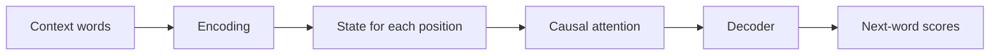
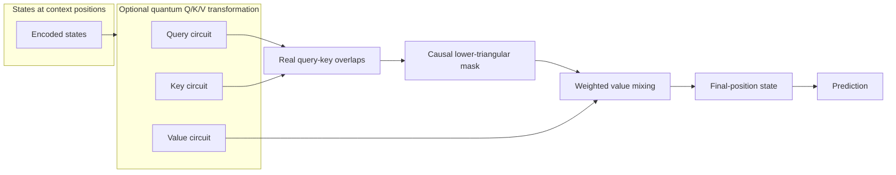
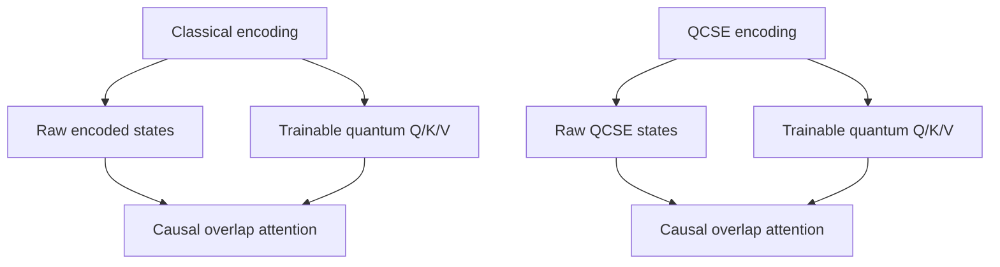
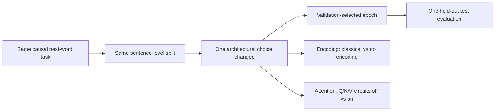

# Architecture changes: encoding and attention

These figures describe the two ablations without discussing their results.

## Figure 1 — Common model path

Encoding decides how words become states. Attention decides how the states at different positions interact.

## Figure 2 — Exact encoding configuration

The encoding comparison changes the representation pathway:

- `classical + trainable ansatz`: all stages above are active and trainable;
- `classical + zero ansatz`: the ansatz is the identity and is frozen;
- `no encoding`: embeddings are averaged and the quantum pathway is bypassed.

There is no explicit one-hot tensor and no context matrix in this encoding model. An embedding lookup is mathematically equivalent to multiplying a one-hot vector by an embedding matrix, but the implementation uses token IDs directly.

## Figure 3 — Where the context matrix appears

This context-matrix path belongs to the QCSE attention encoder and the separate causal QCSE model, not to the classical-encoding ablation above.

## Figure 4 — Attention ablation

The attention comparison is a 2×2 design:

“No quantum attention” still performs causal attention. It only removes the trainable Q/K/V transformations, so query, key, and value are the encoded states themselves.

## Figure 5 — What changes and what stays fixed

The encoding and attention arms are separate experiments. The attention arm uses a small repetitive sanity corpus, while the encoding arm uses the full corpus; their percentages should therefore not be compared directly.
