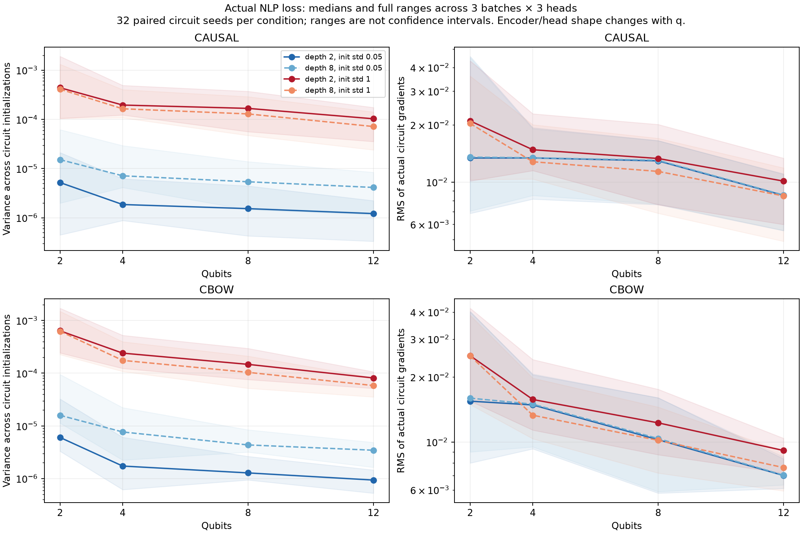

# Replicated NLP gradient audit — 2026-10-20

The new measurements do not establish a barren plateau in this model. Gradients
decrease with register size, but remain clearly nonzero through q12. Small
initialization has low variance across circuit draws **without a vanishing mean
gradient**. The next useful allocation is a controlled context/target training
study, rather than another broad initialization or depth sweep.

## What was checked

Input `robust-gradient-replicated-10324.zip`: 4,584,326 bytes, SHA-256
`dbb4e08704d3b2fd1085b739766941dd62402c55f06865a7fcd53fde9e7403cd`.
The safe extraction contains 385 entries, including directory entries. There
are 144 complete conditions per objective, **288 conditions / 9,216 circuit
gradient evaluations** overall: three batches x three encoder/head seeds x
q2/4/8/12 x depths 2/8 x initialization std .05/1 x 32 circuit seeds.

The independent data-only reproducer is `scripts/audit_gradient_replications.py`.
It checks the submitted job body against the published `d8f8295` launcher and
the executed probe against `d43cc96`; every saved runtime source hash matches
the original `483bea6` checkout and the original study manifest. Both objectives
record job 10324 and the same A100 1g.10gb MIG, with no array ID. The existing
CUDA forward/gradient parity preflight completed all **71 adapters**.

The reviewer independently reconstructs sentence-group test/validation splits
and sampled training IDs from the hash-checked saved corpus. It checks all
24 sampled inputs/targets per objective against the exact original context
recipe. No validation/test examples enter the probe. Every raw gradient/loss
array has the expected finite shape and seed sequence. All variance/RMS/loss
statistics reproduce; the retained batch619/head619 condition reproduces the
saved summaries of all 16 historical conditions per objective. Encoder/head hashes remain fixed
across circuit conditions within q/head.

[summary.json](summary.json) retains all verified condition rows, raw-array
hashes, mean-gradient RMS, minimum circuit-gradient norms, near-zero fractions,
timings and the preflight record. Raw gradients remain in the original local
ZIP. [validation.json](validation.json) records final verification.

## What the gradients say

These are medians over nine crossed batch/head conditions. The variance
reduction compares q2 with q12; it is descriptive, not a fitted scaling law.

| Task | Depth | Init std | q2/q12 variance ratio | q12 gradient RMS | q12 mean-gradient RMS |
| --- | ---: | ---: | ---: | ---: | ---: |
| Causal | 2 | .05 | 4.28 | .008517 | .008434 |
| Causal | 8 | .05 | 3.67 | .008552 | .008260 |
| Causal | 2 | 1 | 4.28 | .010122 | .002125 |
| Causal | 8 | 1 | 5.74 | .008460 | .001515 |
| CBOW | 2 | .05 | 6.45 | .006996 | .006903 |
| CBOW | 8 | .05 | 4.61 | .007022 | .006842 |
| CBOW | 2 | 1 | 7.85 | .009138 | .001846 |
| CBOW | 8 | 1 | 10.73 | .007616 | .001226 |

The small-std cases illustrate why low variance alone is insufficient. For a
smooth loss and a concentrating initializer, gradients approach their value at
the common initialization; their variance can approach zero while that common
gradient stays nonzero. Here the mean-gradient RMS at q12 is almost the total
RMS for std .05. This is not the signature of uniformly negligible gradients.
The first-RX summaries also remain nonzero; conclusions are not based only on
averaging many parameters. The hybrid reads X/Y/Z, so the paper adapter's
Z-only final-diagonal structural-zero mask does not apply to it.

The original barren-plateau result concerns gradient concentration for specified
random circuit ensembles, not any small numerical variance
([McClean et al.](https://www.nature.com/articles/s41467-018-07090-4)). The cost and
circuit assumptions matter; local/global results cannot simply be transferred
to this learned-head word CE
([Cerezo et al.](https://www.nature.com/articles/s41467-021-21728-w)). Near-identity
initialization is a legitimate research direction, but our small Gaussian
initializer is not the identity-block construction of
[Grant et al.](https://quantum-journal.org/papers/q-2019-12-09-214/).

Important limits remain:

- Only four register sizes and two shallow depths; no asymptotic exponential
  versus polynomial conclusion follows from fitting those few points.
- Changing q also changes encoder output and decoder input dimensions and
  their initialization scales. It does not isolate qubit count alone.
- The nine batch/head combinations are crossed, not nine independent training
  runs. Each diagnostic batch has eight targets; the optimizer uses 64 via
  accumulated microbatches. There are only 24 sampled targets per objective.
- These are initialization gradients with an untrained classical head, not
  gradient distributions at trained checkpoints. They neither diagnose nor
  rule out later optimization difficulties.
- This is an exact-state simulator without hardware noise or shot noise.

## Measured duration and next allocation

Saved stage times are **9 s preflight + 220 s causal + 221 s CBOW = 450 s**.
That is 7m30s for those recorded stages, excluding queueing, submission-time
checks and final packaging; the archive does not include full Slurm accounting.
The earlier 252-second-per-objective linear proxy was about 14% above these
measurements. The conservative 10–30-minute combined planning allowance was
therefore high. These timings describe gradient probes, not training fits.

The [next executable protocol](../../BENCHMARK_TARGET_CONTROLS.md) uses 32
development fits, two fresh training seeds and one saved validation fold:

1. Compare L4, L2R2 and L2-with-padded-right slots on identical training and
   validation targets. This directly addresses the demonstrated target-position
   confound and separates adding right context from dropping left context.
2. Retain MLP/BERT/CRZ/identity anchors in all three recipes. In L2R2 add local,
   frozen, XX and ZZ controls to investigate the circuit's role and generators.
3. Keep q8/depth2, LR .003 and 100 x 20,000 draws. Reuse the existing frozen
   training engine; fresh CUDA batch profiles precede all full fits. Maximum
   concurrency remains four 10 GB instances.

Historical fit medians give about **33.9 allocation-hours / 10.9 hours of
sequential-array wall time** before the 1.10 planning margin, new profiles or
queueing. A **12–16-hour planning allowance** is reasonable until the new
profile is available, not a confidence interval or guaranteed finish time.
The driver prints its measured-profile forecast automatically and excludes
refits. It runs no test selection/scoring.

This is an economical fixed-LR discovery study. Two seeds and one reused
validation fold will not support a new confirmatory claim. A new reserved
evaluation population and equal tuning budgets are still required before a
strong generalization claim. Data-mixture/sampling interventions, a recurrent /
count reference and the separate graph-Hamiltonian prototype remain later
blocks; they are not silently included in these 32 jobs.
