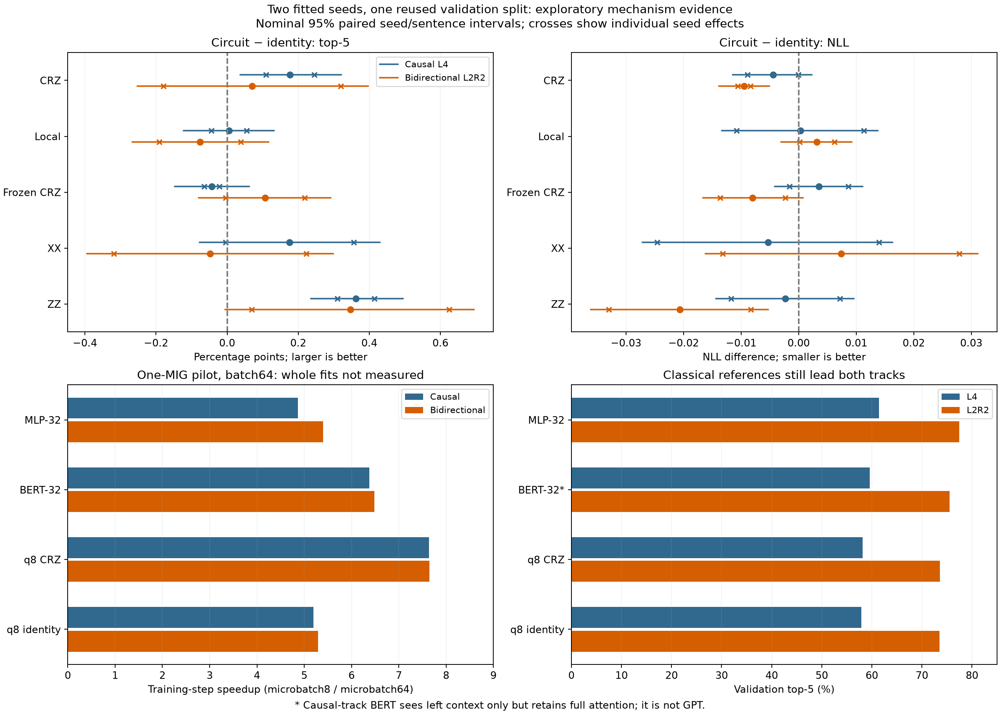

# Completed causal controls and paired two-track review — 2026-10-22

The missing causal mechanism block is complete. **Do not resubmit those eight
fits.** Combining them with the preceding target controls gives eight models
×two training seeds ×two tasks: 32 core records. The eight older L2pad records
remain supplementary; the two cohorts together contain 40 distinct fits.

MLP remains strongest in both tasks. ZZ improves top-5 over identity in both
seeds of each task, but its causal top-1/NLL evidence is mixed. Crucially, the
implemented CRZ and ZZ chains have the **same unconstrained function class**:
their apparent quality difference cannot establish greater expressivity.

The next priority is to validate the measured execution optimization and add
matched classical architecture/feature controls. See the
[next-experiment specification](../../BENCHMARK_POST_CAUSAL_PLAN.md) and
[project/literature review](../../PROJECT_RESEARCH_REVIEW.md).

## Evidence and independent checks

Input: `causal-controls-20261022T012543Z-q1n83tfn-diagnostics.zip`, 9,705,351 bytes,
132 regular entries; ZIP CRC and safe relative paths checked. Archive SHA256:

```
1e2d55fd2cad3c07e4efcda739c5111192cfca88f9918c5a3f1b38edb432c1b1
```

The audit verifies all 131 exported file hashes, 34 frozen training source files
against 483bea6 and three extension files against 6d8ca19. Included parent
manifests, sentence sums and result ledgers also match the preceding downloaded
cohort byte-for-byte. The saved pilot batch is reconstructed from the corpus,
split, target keys and sampler seed; paired model initialization fingerprints
match across pilot contexts. The emitted profile job matches its frozen script.
The new manifest is
`597a8e13ef26eed8b83700932f720a68c3c2370ef55af78d8800cce09fb16c6d`.

All eight new jobs completed successfully on a 10 GB CUDA MIG device, 100 epochs each,
31,300 updates and 2,000,000 replacement draws, LR 0.003, optimizer batch 64,
microbatch 8, q8/depth 2/std 0.05. Final scoring uses epoch 100, not a selected
monitor epoch. Independent split/target reconstruction matches train,
validation, development and test hashes. Validation has 32,348 sentence groups
and 252,120 positive-position targets; training has 129,390 groups and 1,014,085
eligible targets. All contexts exclude the target. L4 contains four left slots;
L2R2 contains two left/two right slots. Padding is not a vocabulary word.

The corpus has 202,172 deduplicated sentences and 10,864 words. Its vocabulary
was constructed before splitting, a disclosed transductive convention. The
outer test has already been used in earlier project work and was not rescored
here. The core comparison uses one reused validation fold, not a fresh test.

**Limits:** 25 omitted files include prepared arrays, token predictions and
checkpoints. Cluster sums can reproduce aggregate metrics/paired intervals,
but cannot establish correctness of omitted token-level predictions, actual sampling
streams, resume state, calibration, full MRR or source/frequency strata. The
audit checks saved evidence; it does not rerun DGX training.

## Full-word quality

Means over seeds 47/48; accuracy columns are percentages. Lower NLL is better.
These are within-task fixed-recipe comparisons, not equally tuned architecture
rankings. Causal-track BERT receives only left context but still uses full
attention and an appended MASK query; it is not a GPT decoder.

| Model | L4 NLL | L4 top-1 | L4 top-5 | L2R2 NLL | L2R2 top-1 | L2R2 top-5 |
| --- | ---: | ---: | ---: | ---: | ---: | ---: |
| MLP-32 |3.248730|35.6560|61.4632|2.206363|54.8931|77.4518|
| BERT-32 |3.330437|34.0838|59.5464|2.307967|51.7222|75.5529|
| q8 CRZ |3.466374|33.3163|58.1190|2.468397|50.2348|73.5967|
| q8 identity |3.470825|33.3567|57.9419|2.477890|50.0319|73.5261|
| q8 local |3.471120|33.1927|57.9474|2.481080|49.9931|73.4495|
| q8 frozen CRZ |3.474374|33.5174|57.8990|2.469915|50.1011|73.6336|
| q8 XX |3.465515|33.3782|58.1176|2.485275|50.0442|73.4787|
| q8 ZZ |3.468542|33.2594|58.3042|2.457248|50.3782|73.8728|

MLP wins all three endpoints in both seeds of both tasks. Its top-5 advantage
over BERT is 1.917pp causal and 1.899pp bidirectional. No quantum quality or
compute advantage over the strongest classical reference is established.
MLP-32/BERT have 368880/385394 parameters versus 186190 for q8 CRZ: this is not
a capacity-matched architecture win. The next design includes MLP-16 (187312)
and a shared-encoder classical feature control (186824); neither has yet been
trained under this matched-target protocol.
Autoregressive and bidirectional conditional NLL are different estimands;
do not compare their exponentials as a common perplexity.

## Paired effects and robustness

10,000 paired seed/sentence bootstrap draws, RNG seed 42, shared group and seed
multiplicities across models/tasks. Intervals are nominal 95%, exploratory and
uncorrected for selection/multiple comparisons. Two training seeds provide
limited information about optimization variability; two tasks do not create
four independent initializations. Sentence-only intervals are also retained
in `audit.json`, but exclude between-seed uncertainty.

| Contrast | Mean top-5, pp | Nominal 95% interval, pp | Interpretation |
| --- | ---: | --- | --- |
| L4 ZZ−identity |+0.3623|[+0.2353,+0.4952]|Both seed effects positive: +0.4145,+0.3102pp.|
| L2R2 ZZ−identity |+0.3467|[−0.0052,+0.6947]|Both positive, but very different magnitudes: +0.6243,+0.0690pp.|
| L4 CRZ−frozen CRZ |+0.2199|[+0.0982,+0.3445]|Both seed effects positive; circuit learning affects this endpoint.|

The causal trainable-versus-frozen finding **changes the previous conclusion**:
CRZ improves NLL by 0.00800 in both seeds, while top-1 falls 0.2011pp, also in
both seeds. Its top-1 seed/sentence interval crosses zero. Bidirectional
trainable-versus-frozen remains mixed (top-5−0.0369pp). “Frozen” means the
circuit is frozen: its encoder and word head still learn.

ZZ's causal NLL gain averages−0.00228 but changes sign between seeds. Its
sentence-macro NLL difference is instead+0.00135, and causal top-1 averages
−0.0974pp. Different weighting of short/long sentences changes the NLL story;
this does not yet identify frequency, source, confidence or rank movement as
the cause. Top-5 gains warrant targeted error analysis and new-seed confirmation,
not a universal “better Hamiltonian” claim.



## Circuit coordinates and classical simulation

This is our derivation for the actual implementation, independently checked
on tiny states; it is not an attributed empirical result from another paper.
With the standard `RZZ(eta)=exp(-i eta Z⊗Z/2)` convention:

```
CRZ(c,t,g) = RZ_t(g/2) RZZ_ct(-g/2).
```

Every CRZ/ZZ and local RZ gate in each current chain layer commutes. Keep RX
angles, add half each CRZ coupling to its target's local RZ angle and map the
edge coupling to−g/2. This invertible map reproduces the whole unitary at any
depth/input state. It requires identical edges and free local RZ fields per
layer; it does not compare all possible architectures.

Independent std 0.05 initializations are not corresponding functions: mapped
ZZ couplings have std 0.025 and become correlated with local fields. Coordinate-
wise Adam is not invariant under this non-orthogonal map. Next test matched
initial functions/changed optimizer coordinates, rather than interpreting
CRZ-versus-ZZ as an expressivity comparison. State, input-gradient and mapped
parameter-gradient parity passes 18 float 64 CPU conditions (q2/3/8, depth 1/2/4,
two seeds), maximum absolute discrepancy 3.55e−15.

For the **hybrid's product-state inputs**, each CRZ/ZZ/XX chain layer has one
operator-Schmidt-rank-two gate crossing each cut. Starting from rank 1 gives
Schmidt rank ≤ 2^depth at every cut, hence≤4 at depth 2. Local rotations do not
increase it. The 18 additional q8 state checks respect this bound at depths 1/2/4.
Consequently a matrix-product-state evaluator can simulate these fixed-depth
chains with cost polynomial in qubits, exponential in depth; the tensor-network
basis is described by [Vidal 2003](https://arxiv.org/abs/quant-ph/0301063).
This is an exact-computation opportunity, not a measured speedup or an
implemented differentiable backend. It does not automatically cover the paper
adapter's entangled context encoder, ring edges or growing-depth circuits.

## Compute and optimization pilot

New fit array 10400: **15.3573 MIG-hours**, elapsed 3h52m33s, peak overlap four.
Fresh forecast: 16.3910 MIG-hours /4.1520h. Observed work and span were
6.31% and 6.65% below forecast, respectively.
Times cover fit-job wrappers only: pilot/preflight/profile, queueing and
packaging excluded. Full Slurm allocation accounting was not exported.

Pilot 10399 ran on one 10 GB MIG, 64 conditions, five timed steps after warmup,
both tasks/four anchors/full 64 and partial 32 examples. All recorded loss,
logit, accumulated-gradient, one-Adam-parameter/moment checks pass their saved
tolerances. Largest absolute differences: loss 9.54e−7, logits 2.15e−6,
gradients 1.34e−7, parameters 1.45e−5, moments 1.30e−8. These are recorded summary
checks, not independently replayed CUDA tensors on this Mac.

| Model, batch 64 | L4 micro 8→64 ms | Step speedup | L2R2 micro 8→64 ms | Step speedup |
| --- | ---: | ---: | ---: | ---: |
| MLP |8.835→1.816|4.87×|8.950→1.659|5.40×|
| BERT |50.056→7.853|6.37×|50.215→7.750|6.48×|
| CRZ |230.543→30.197|7.63×|230.164→30.087|7.65×|
| identity |11.244→2.165|5.20×|11.390→2.153|5.29×|

Maximum PyTorch reserved memory 113.25 MB is not whole-device memory usage.
Timings are single-batch medians, not uncertainty bounds. Parity used eval
mode to disable dropout; timed steps used normal training. One update does
not establish long-run numerical/statistical equivalence, particularly for
BERT dropout. Evaluation/checkpointing/setup were not accelerated or profiled
at micro 64 here; whole-fit speedup cannot be obtained by dividing by 7.65.
The eight scientific fits deliberately kept micro 8.

All new trainable circuit histories retain nonzero layer gradient RMS
(minimum 0.0161 across recorded active layers); clipping fraction is zero.
Sampled monitor NLL improves 0.0325–0.0719 between epochs 50/100, and top-5
improves 0.537–2.148pp. These 2048-target monitor endpoints are not full-validation
convergence tests and do not prove or exclude a barren plateau at larger q.

The reconstructed sampler implies 86.082%/86.107% unique training targets seen
at seeds 47/48 (expected 86.085%). Two million replacement draws are about 1.97
passes in expectation, not 100 complete corpus passes. This is a replay from
the saved seeds/frozen sampler, not a verification of the omitted DGX draw
stream. All eligible targets remained available.

## Reproduce the analysis locally

After safe extraction, from the repository root (one CPU thread):

```bash
export OMP_NUM_THREADS=1 OPENBLAS_NUM_THREADS=1 VECLIB_MAXIMUM_THREADS=1 MKL_NUM_THREADS=1
.venv/bin/python scripts/audit_causal_controls.py \
  outputs/causal-controls-review/archive/causal-controls-20261022T012543Z-q1n83tfn \
  --parent-root outputs/target-controls-review/archive/target-controls-20261021T015800Z-ij4_p682
.venv/bin/python scripts/probe_gate_coordinates.py \
  --output results/robust-causal-controls/gate-coordinate-probe.json
MPLCONFIGDIR=/tmp/qcse-matplotlib .venv/bin/python scripts/plot_causal_review.py
```

`--parent-root` adds bytewise checks against the separately downloaded parent;
the new export already contains its hash-bound compact anchors. Files here:
`audit.json` (contrasts, histories, timing, validation and replay details),
`core-fits.csv`, `mean-scores.csv`, `pilot-step-times.csv`,
`gate-coordinate-probe.json`, figure, `prototype-capacity.json` and
`review-provenance.json`.
Raw archives/checkpoints/corpus copies and conversation exports remain local.

No new DGX jobs or local corpus training were run during this review.
