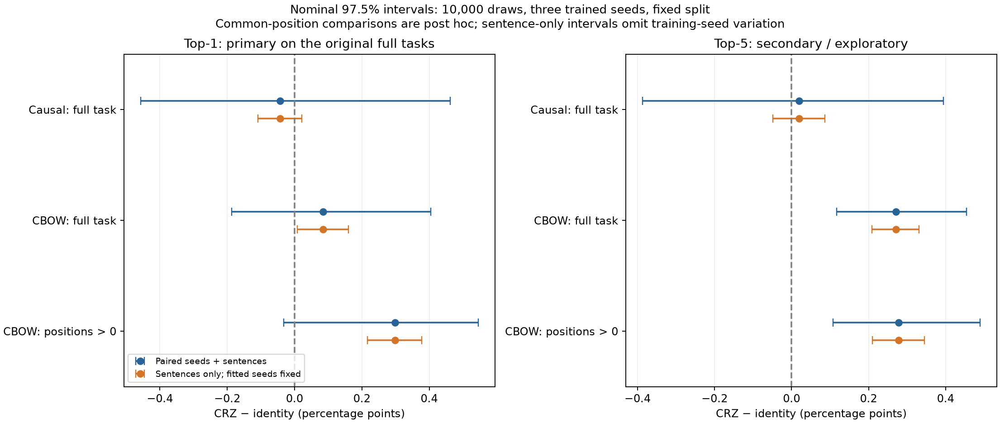
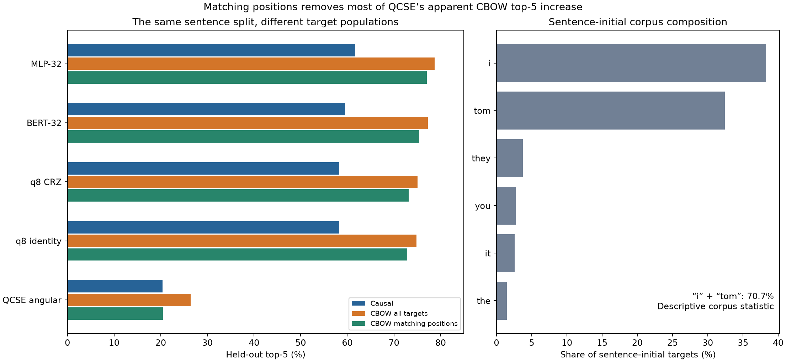

# Corrected prediction review — 2026-10-20

The reporting repair preserves the main ranking and the inconclusive primary
top-1 contrast. It also strengthens a narrower exploratory observation:
**CRZ improves CBOW top-5 and NLL over identity in all three trained seeds**.
That improvement survives seed deletion, sentence-macro weighting and matching
target positions, but is small relative to the cost and does not beat the MLP.

A second finding changes the interpretation of QCSE: its apparent CBOW top-5
gain over causal nearly disappears when both score the same target positions.
Evaluation composition must be controlled before making a bidirectionality or
semantic-representation claim.

## Provenance and independent checks

- Input `robust-followup-prediction-review.zip`: 21,352,437 bytes; four files.
  SHA-256 `aad5ce58af19e7a2467d39a86318a55fd1f754408d21ef74540553a129ef867d`.
  Both corrected reports link to the original frozen manifest/selection and
  preserve all 30 refit ledger rows exactly.
- Executed analyzer matches `369790b:src/qcse/benchmark_report.py`, SHA-256
  `792f0c882b71de070fa8d5b57b6959a64dbcfca99d3b23e9df4a518c363a4c02`.
  Each report's cluster-file checksum agrees with the actual NPZ bytes.
- Independently reconstructed the held-out group IDs, per-sentence target
  counts and common `(group, position, target)` keys from the saved corpus,
  after checking its manifest/artifact hashes. Both common-target hashes equal
  `dcc0f6a54ec91b05156cf21d152ac5bd178f56fa81f4f4f9b3091e2f4d0ef38f`.
  Counts are 316,751 common targets and 40,434 additional CBOW initial targets.
- Rebuilt the smoothed frequency model from development-only counts, then
  checked every exported per-sentence frequency sum for every seed, including
  the common-position subset. Verified group metric shapes, finite/nonnegative
  NLL sums, integer retrieval counts, top-1 <= top-5 <= group size, seed labels,
  subset consistency and all corrected means/seed SDs.
- Independently regenerated **all 30 original 2,000-draw intervals**, including
  NLL/top-1/top-5 endpoints, within 1e-10 using a different aggregation method:
  group/seed multiplicities rather than repeated token indexing. A tiny
  unequal-length-sentence test also compares that algorithm directly with raw
  token resampling. Chunk size preserves the RNG sequence.
- Extended the same deterministic resampling sequence to **10,000 draws**, with
  one-thread numerical-library settings and bounded working chunks. The extra
  draws assess Monte Carlo endpoint stability; they add no training seeds.

[summary.json](summary.json) preserves the corrected reports, reconstructed
checks, 2,000- and 10,000-draw intervals, sentence-only comparisons, empirical
seed-only sensitivity, leave-one-seed-out and macro means.
[scores.csv](scores.csv) contains population-specific point estimates.
The reproducer is `scripts/review_prediction_clusters.py`; use the extracted
prediction archive, `--study-root` pointing to the four original diagnostic
studies, `--archive ZIP`, and `--draws 10000`. The plot reproducer is
`scripts/plot_prediction_review.py`.

These are verified sufficient statistics for this seed/sentence bootstrap.
They do **not** permit independent reconstruction of raw logits, ranks,
contexts, optimizer states or circuit gradients. That remaining limitation is
narrower than before, but has not vanished.

## Corrected primary contrast and exploratory top-5

CRZ minus identity. Values are percentage points; intervals are nominal 97.5%
paired seed/sentence percentile intervals from 10,000 draws. The original full
task top-1 contrasts were prespecified. Top-5 and matching-position results
are secondary/post hoc, even when displayed at the same confidence level.

| Population | Top-1 difference | Top-1 interval | Top-5 difference | Top-5 interval |
| --- | ---: | --- | ---: | --- |
| Causal, original task | −0.0423 | [−0.4568, +0.4621] | +0.0198 | [−0.3870, +0.3949] |
| CBOW, original task | +0.0853 | [−0.1871, +0.4047] | **+0.2705** | **[+0.1166, +0.4540]** |
| CBOW, common positions > 0 | +0.2978 | [−0.0328, +0.5453] | **+0.2787** | **[+0.1079, +0.4892]** |

On original CBOW, the three top-5 differences are **+0.4314, +0.2223,
+0.1579 pp**. Leave-one-seed-out means range **+0.1901 to +0.3269 pp**.
Sentence-macro weighting gives **+0.2627 pp**, compared with token-weighted
+0.2705. Thus the observed top-5 direction is not created by one seed or solely
by weighting longer sentences more heavily. This is evidence about these
three fitted models and this corpus, not a reliable guarantee for unseen seeds.

On common positions, all three top-5 differences are also positive:
**+0.4682, +0.1657, +0.2021 pp**. The corresponding macro difference is
+0.2506 pp. Top-1 still has an interval crossing zero, even though its
leave-one-seed-out means are positive on that subset. The subset was examined
after the outcomes; it must not replace the original primary population.

Corrected CBOW NLL difference is **−0.020392 nats**, interval
**[−0.024477, −0.016271]**. All three seed differences are negative, and
deleting any seed preserves that direction. On common positions it is
−0.022464 nats, interval [−0.028281, −0.017041]. Causal NLL is −0.011118 nats
with interval [−0.028162, +0.005347], remaining inconclusive when seed
uncertainty is included. These are float64 aggregates of stored float32
per-token evaluation values, not new float64 model inference.

The top-5 finding was not the prespecified primary endpoint and LRs were
selected for top-1. The nominal intervals are not a multiplicity correction
for all metrics, pairs and newly examined subgroups. It would be misleading
to rename the completed experiment a confirmatory top-5 win. A prospective
top-5 study with equal tuning effort is now a well-motivated next question.

Rechecking the saved development selections gives an important economy:
**top-1 and top-5 both select LR 0.003 for BERT, MLP, CRZ and identity in both
tasks**, among 0.0003/0.003/0.01. The reproducer records all eight checks and
the hash-bound candidate scores. Thus this grid offers no evidence that
changing the selection endpoint would change these configurations. Do not
repeat the identical grid solely to relabel it top-5; freeze this existing
development decision when reusing the same task. New targets, samplers or
architectures can require new tuning. This agreement does not retroactively
prespecify top-5, supply independent seeds, or turn this test into unseen data.

## Why keeping training-seed uncertainty matters

If the three fitted models are treated as fixed and only test sentences are
resampled, CBOW top-1 gets a narrow nominal interval **[+0.0085, +0.1605] pp**.
Resampling paired training seeds as well expands it to **[−0.1871, +0.4047] pp**.
Similarly, causal NLL appears consistently improved under sentence-only
resampling but crosses zero once initialization variability is included.

These procedures answer different questions: conditional predictions of these
particular fitted models versus variation represented by the empirical seed
sample. Neither learns the full distribution of training runs from three
seeds. The bootstrap seed component has only ten unordered three-draw
multisets. More resampling draws cannot correct missing seed/split/tuning
variation. Keep per-seed values and effect sizes visible, consistent with the
run-distribution guidance in [Reimers and Gurevych](https://aclanthology.org/D17-1035/)
and the broader variance discussion in
[Bouthillier et al.](https://arxiv.org/abs/2103.03098).

## Matching target positions changes the QCSE story

| Model | Causal top-5 % | CBOW full top-5 % | CBOW common-position top-5 % | CBOW initial-position top-5 % |
| --- | ---: | ---: | ---: | ---: |
| MLP-32 | 61.7007 | 78.7499 | 77.0173 | 92.3233 |
| BERT-32 | 59.4845 | 77.2855 | 75.4430 | 91.7198 |
| q8 CRZ | 58.3172 | 75.0890 | 73.1689 | 90.1304 |
| q8 identity | 58.2974 | 74.8185 | 72.8903 | 89.9235 |
| QCSE angular | 20.4133 | 26.4489 | **20.4994** | 73.0565 |
| Original training frequency | 21.6893 | 26.4373 | 20.4751 | 73.1439 |

QCSE's apparent cross-task increase is **+6.0356 pp** with the original full
CBOW population but only **+0.0861 pp** on matching positions. Its common-position
CBOW NLL is **5.720082**, compared with causal **5.710837**, so the apparent
aggregate NLL improvement also disappears under that population comparison.
The original full CBOW NLL is correctly **5.542457**, not 5.532076 from the
float32 reporting bug.

Sentence-initial tokens are 11.32% of CBOW targets; **“i” and “tom” account for
70.70% of those initial words**. That is a descriptive corpus property, not a
diagnosis of which words the models confuse. A new post-hoc count reference,
using development-only sentence-initial frequencies and the same add-one
smoothing, gets **38.297% initial top-1 / 79.725% top-5 / NLL 2.29554**. It uses
position but no context. This is stronger than the original global-frequency
reference for that subgroup and illustrates why position-aware count controls
belong in the next classical comparison. It was not a prespecified baseline.

For the hybrid pair, sentence-initial top-1 differences are **−2.9134,
−0.4625, −1.3627 pp** across the three seeds: all negative. Noninitial
differences are +0.4098, +0.4934, −0.0098 pp. The boundary behavior is a useful
encoding/padding/ranking hypothesis; it does not justify discarding the
unfavorable initial-word stratum after seeing it. Missing raw top-k IDs mean
we cannot yet identify the specific word substitutions responsible.

Matching evaluation positions removes this target-composition confound, but
does not isolate a causal effect of right context: the trained models also
saw different training target populations and different context placements.
The proposed L2-only versus L2R2 common-slot experiment is still needed for
that narrower information question.

## Classical ranking and practical relevance

MLP remains best on top-1, top-5 and NLL in both original tasks and on the common
position population. Its top-1 advantage over BERT is **+1.6946 pp causal** and
**+2.5801 pp CBOW**; on common positions it is +2.6286 pp. These findings retain
the scope limitations of the
[completed study](../robust-followup/README.md): short word contexts, no external
pretraining, near-capacity rather than exact FLOP matching, transductive vocabulary
and one sentence-grouped outer split.

CRZ's original CBOW top-5 is 75.0890%, compared with identity 74.8185%, BERT
77.2855% and MLP 78.7499%. The measured CRZ fit still costs about **18 times**
identity. A small consistent auxiliary gain is scientifically interesting;
it is not a practical quality/cost victory over the strongest classical model,
nor evidence of quantum hardware advantage. A learned classical nonlinear
feature block and an equally tuned identity reference are important next controls.

## Decisions for subsequent work

1. **The numerical repair and aggregate interval audit are complete.** No more
   old fits are needed. Preserve both archives and their hashes. Raw-context /
   rank/checkpoint audit remains a separate, clearly bounded missing layer.
2. **Prioritize a prospective CBOW top-5 contrast**, retaining full-population
   scoring and prespecified boundary/nonboundary breakdowns. Keep top-1 and NLL
   as secondary guardrails, equal LR selection budgets, the matched identity,
   a classical nonlinear feature control and MLP/BERT anchors. Use new
   development seeds and a separately reserved evaluation population for a
   new confirmatory claim; this test is now observed. Reuse the already
   endpoint-consistent LR decision for unchanged arms rather than paying for
   the same grid again. More same-split folds would not resolve independence
   from this corpus or expose the missing rank/gradient mechanisms.
3. **Control target recipes before pooling task conclusions.** Use the same
   training/evaluation target positions for the controlled causal/CBOW side
   comparison and the proposed L2/L2R2 common-slot ablation. Retain the original
   full-CBOW task as its own declared endpoint, not an inconvenient stratum
   silently removed during analysis.
4. **Run the replicated head/batch gradient probe before more deep fits.** It
   addresses a limitation the aggregate prediction archive cannot resolve.
   Do not infer barren plateaus from these top-k patterns or group averages.
5. **Use the separate Hamiltonian/data blocks already designed**, after their
   runner support and fresh profiles exist. Gate generators and a train-only
   graph Hamiltonian are different questions. Source/sentence sampling must
   change training probabilities while keeping evaluation and eligible pools
   fixed. Position/source composition is now a demonstrated reason to log those
   distributions, rather than treating all accuracy changes as architecture gains.

The [next-study design](../../BENCHMARK_NEXT_STUDIES.md) remains the implementation
roadmap. This review supplies its missing corrected-statistics gate; it does
not turn the still-unimplemented neural/data/graph blocks into runnable jobs.

## Compute and reproducibility status

This step needs **zero DGX training fits**. Local resampling is CPU analysis,
bounded to one numerical-library thread and 32 draws per working chunk. It
does not change any saved model or selection. The completed follow-up consumed
348.443 allocation-hours across 292 successful allocations, with a maximum of
four concurrent 10 GB instances; those are measurements, not a budget for new
architectures or data policies.

For the next implemented diagnostic, the proposed three-batch/three-head grid
costs nine times the old single-condition probe: roughly 4.2 minutes per
objective by the old 28-second profile, allowing 5–15 minutes until measured
on CUDA. This is a planning extrapolation, not a new DGX measurement. It needs
one MIG at a time and precedes any long fitting decision. The broader neural,
sampling and graph designs need implementation and measured pilot profiles
before defensible allocation estimates or production submission commands.

The focused helper tests compare resampling against raw token observations and
check invalid weights. [validation.json](validation.json) records the actual
checks and source hashes. Raw contexts/logits/top-k IDs, a new evaluation corpus
and replicated trained-model gradients remain unavailable in this archive.
