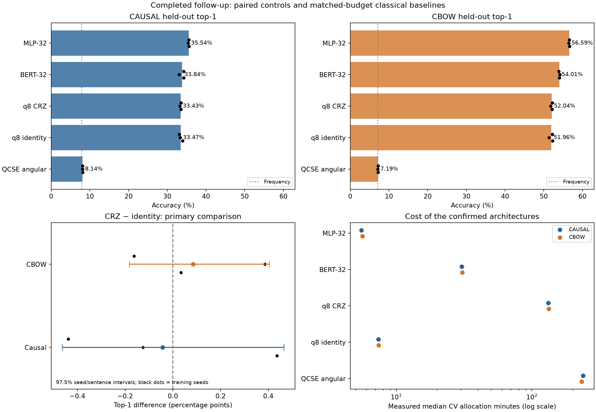
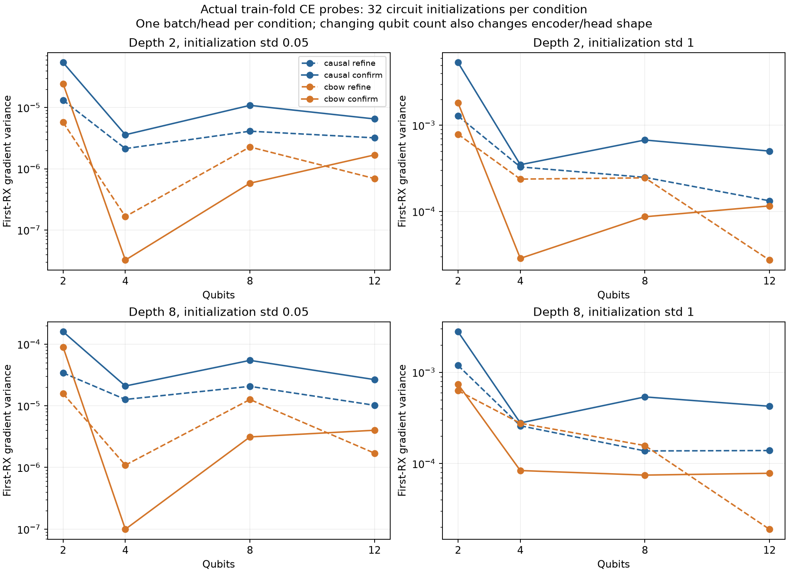

# Completed follow-up: conclusions and robustness — 2026-10-20

The subsequent [corrected prediction review](../robust-followup-prediction-review/README.md)
now verifies all 30 paired intervals from exported sentence statistics, resolves
the NLL precision issue and reports common-position/top-5 sensitivity. This
document preserves the initial diagnostic-audit scope and ledger-based tables.

The strongest result is a **classical baseline correction**: near-capacity
MLP-32 beats BERT-32 on both tasks, in every paired confirmation validation fit
and every held-out training seed. The primary hypothesis of a useful CRZ top-1
improvement over its matched identity control is **not supported**. Small
secondary CBOW NLL/top-5 improvements are worth retaining, but do not outweigh
the much larger cost or establish a general quantum benefit.

The right next step is to finish prediction-level verification and address
external validity, rather than repeat the large grid. No new training batch
was launched during this review.

## What was actually checked

Archive `robust-followup-diagnostics.zip`: **12,371,326 bytes**, 2,685 files,
88,826,886 expanded bytes. SHA-256:
`bfb71bdb8035851723decf54a4a7f3829530fda48bed95b7f2c2f3279bd818d6`.
It contains JSON/text diagnostics, not the binary predictions or checkpoints.

`scripts/audit_benchmark_followup.py` independently checks:

- All **34 recorded source hashes** against commit `483bea6`, all four manifest
  and selection fingerprints, included prepared JSON artifacts, both input CSV
  hashes and refinement-to-confirmation parent links. The only declared dirty
  item was untracked `test.sbatch`.
- All **258 CV fits + 30 refits**, their identities, histories, full final
  evaluation counts, **100 epochs / 2,000,000 draws / 31,300 updates per fit**,
  CUDA device metadata, successful phase ledgers and timing CSVs.
- Expected grouped split membership/counts and training-only frequency metrics,
  reconstructed directly from saved sentence words. Causal and CBOW use the
  same 40,434 held-out sentence groups, but different token targets.
- Candidate aggregates and deterministic LR selection. Both tasks selected
  LR **0.003** for BERT, MLP and the common CRZ/identity pair. All five
  confirmation architectures survived into each three-seed held-out report.
- All **292 allocations** completed with exit `0:0`, with **peak concurrency
  four** across the complete workflow. Four short CV tasks reused pilot fits.
  The log freezes all four validation selections before the first refit.

The prepared NPZ indices, actual contexts, raw per-example predictions, ranks,
checkpoint tensors and raw gradient arrays were **not included**, so they were
not independently revalidated here. The successful DGX selection/report code
checks saved prediction alignment, ranks and budgets; this review verifies
the exported evidence and its consistency, not an independent rerun of that
binary validation. Published intervals below are retained from the DGX reports,
not regenerated from this archive.

Durable evidence: [summary.json](summary.json), [288 fit ledgers](fits.csv),
[292 filtered allocations](accounting.psv), [local validation](validation.json).
The summary preserves original
reported intervals, all refinement candidates, expected counts, per-seed
metrics, leave-one-seed-out differences and the 64 NLP probe conditions.
Regenerate it with the audit script on the extracted `outputs/robust-followup`
folder and `--archive PATH`; no training or GPU is needed.

## Held-out results

Three training seeds, one fixed held-out population. Top-1/top-5 are percentages;
SD is **sample SD across the three trained models**, not a confidence interval.
NLL uses per-fit ledger means provisionally: see the numerical issue below.
Cost is median full CV allocation time, not inference latency.

| Causal model | Top-1 % | Seed SD (pp) | Top-5 % | NLL, ledger | CV minutes |
| --- | ---: | ---: | ---: | ---: | ---: |
| MLP-32 | **35.537** | 0.114 | **61.701** | **3.2452** | **5.52** |
| BERT-32 | 33.842 | 0.680 | 59.484 | 3.3232 | 30.35 |
| q8 CRZ | 33.432 | 0.179 | 58.317 | 3.4454 | 132.13 |
| q8 identity | 33.474 | 0.428 | 58.297 | 3.4566 | 7.37 |
| QCSE angular | 8.137 | 0.018 | 20.413 | 5.7108 | 238.13 |
| Training frequency | 7.898 | — | 21.689 | 5.4461 | — |

| CBOW model | Top-1 % | Seed SD (pp) | Top-5 % | NLL, ledger | CV minutes |
| --- | ---: | ---: | ---: | ---: | ---: |
| MLP-32 | **56.586** | 0.092 | **78.750** | **2.1027** | **5.62** |
| BERT-32 | 54.006 | 0.130 | 77.286 | 2.1837 | 30.65 |
| q8 CRZ | 52.043 | 0.252 | 75.089 | 2.3555 | 133.25 |
| q8 identity | 51.958 | 0.511 | 74.818 | 2.3759 | 7.42 |
| QCSE angular | 7.190 | 0.051 | 26.449 | 5.5425 | 232.90 |
| Training frequency | 7.127 | — | 26.437 | 5.2660 | — |



The MLP has 368,880 parameters versus BERT's 385,394, a 4.3% difference. Its
test top-1 advantage is **+1.6946 pp causal / +2.5801 pp CBOW**. Across the 15
paired validation fits the advantages are +1.4464 / +2.6167 pp, positive in
every fit. All three held-out seed differences are positive: causal
`[+1.2704, +2.3697, +1.4437]` pp; CBOW `[+2.7238, +2.3537, +2.6628]` pp.
Dropping any one seed preserves the MLP's advantage. Exploratory 95% paired
seed/sentence intervals are `[+1.2639, +2.3435]` pp causal and
`[+2.3624, +2.7696]` pp CBOW after reversing the exported BERT-minus-MLP contrast.
These are strong within-protocol observations, not an architecture theorem.

The previous screen's BERT win was against the smaller MLP-16. Matching capacity
and LR search changes the conclusion. BERT remains a randomly initialized
two-layer word-level MLM architecture, with four context words, no WordPiece
or external pretraining and no original pretraining corruption/NSP. These
results do not compare against pretrained BERT, longer-context Transformers or
converged architecture-specific training schedules. MLP's cost is about 5.5
times lower here, but equal exposure/update budgets are not equal wall time or
proof that either model is optimally trained.

## Primary circuit result and secondary signals

The prespecified comparison is CRZ minus identity top-1, with one common
validation-selected LR, same-depth encoder/head initialization and paired
training/evaluation examples. Reported **97.5%** intervals account for the two
planned objective-specific top-1 contrasts:

| Task | Mean top-1 difference (pp) | 97.5% interval (pp) | Seed differences (pp) |
| --- | ---: | --- | --- |
| Causal | −0.0423 | [−0.4634, +0.4655] | +0.4363, −0.1247, −0.4385 |
| CBOW | +0.0853 | [−0.1822, +0.4045] | +0.0336, +0.3852, −0.1629 |

Both intervals include zero. Leave-one-seed-out means also change sign for
both tasks. More circuit parameters are not supported as a reliable top-1
improvement here. This does **not** establish equivalence or universal absence
of a useful quantum circuit. No practical-equivalence margin was prespecified;
choosing one now would make it an exploratory interpretation.

The CBOW pair has a secondary NLL improvement of about **0.0204 nats** and
top-5 improvement **+0.2705 pp**. Its exported intervals exclude zero for those
metrics (NLL `[-0.02433, -0.01621]`, top-5 `[+0.1205, +0.4453]` pp), but the
formal primary metric was top-1; these are conditional exploratory findings,
not an independently confirmed main win. Correct float64 prediction-level
reaggregation is still needed. Even with these signals CRZ trails the MLP and
BERT. It takes about **18 times** the identity control's current CV allocation
time; neither cost is a real quantum hardware runtime.

The identity implementation is an exact classical trigonometric feature map.
Its roughly 7.4-minute measured fits make it a useful cheap control. Comparing
these fits with the old three-fold implementation would mix source, seeds and
evaluation sizes; do not label that cross-study ratio an isolated optimization
speedup. The current matched CRZ-versus-identity cost comparison is valid.

Refinement's local/frozen/XX/ZZ controls cluster near identity. Causal XX is
33.333% versus identity 33.201%; CBOW local is 51.974% versus identity 51.723%.
They used one LR/one seed, not the full tuning budget of the four main groups,
and were intentionally not promoted using test results. These small exploratory
differences do not justify a new depth-by-generator Cartesian sweep. Mean std
0.1 barely changes poor top-1: 4.414% versus 4.286% causal, 7.865% versus 7.912%
CBOW. Initialization scale alone did not rescue that baseline.

## Robustness: what is established and what remains conditional

1. **Execution and fixed-budget integrity are well supported.** All recorded
   fits completed the intended budget and all five confirmation arms were
   retained. No best-seed selection, early stopping or reduced eligible pool is
   evident. Five-fold training uses roughly 64% of sentence groups, compared
   with 53.33% in refinement and 80% in final refits. Cross-stage absolute scores
   need not match even for the same model.
2. **Three seeds remain three initialization replicates.** Five overlapping
   training folds are not 15 independent replications. A bootstrap over three
   seed labels has only ten distinct unordered three-draw seed multisets;
   2,000 draws improve numerical sampling of the empirical distribution, not
   knowledge of unseen training seeds. Do not treat interval endpoints as
   precisely calibrated population guarantees. MLP's consistent ordering is
   more convincing than the seed-sensitive circuit contrast.
3. **The split and population are fixed.** Exact duplicate sentences/windows
   are grouped; semantic templates, near duplicates, authors, domains and
   sources are not independently held out. The bootstrap conditions on the
   fitted models, selected LRs and this sentence population. It does not
   integrate split selection or the whole tuning procedure. The vocabulary /
   frequency-ranked IDs use both full sources before splitting, a declared
   transductive protocol. No strictly inductive or new-domain claim follows.
4. **Causal versus CBOW is not a pure information intervention.** Causal test
   has 316,751 targets; CBOW has 357,185, adding the first word of each of the
   40,434 sentences. It also changes context placement to two left/two right
   words. The higher CBOW accuracies cannot be attributed solely to access to
   future words. An immediate analysis is to compare both on the common
   `(sentence, position > 0, target)` population from saved predictions.
5. **Exposure is fixed, convergence is not.** Refits see 2 million replacement
   draws from approximately 1.27M causal / 1.43M CBOW training targets: only
   about 1.58 / 1.40 pool-equivalent passes, not 100 full passes. MLP/BERT
   monitor curves still improve between epochs 50 and 100. Claims about
   asymptotic model quality need a separate convergence/compute comparison.
6. **The test is now observed.** New architectures, generators or data choices
   motivated by these outcomes require a new outer split or external final
   evaluation to support a fresh confirmatory claim. Repeating many settings
   against this same test would turn it into development data.

This interpretation follows the emphasis on run distributions in
[Reimers and Gurevych](https://aclanthology.org/D17-1035/), multiple sources of
benchmark variance in [Bouthillier et al.](https://arxiv.org/abs/2103.03098),
and task-appropriate NLP statistical units in
[Dror et al.](https://aclanthology.org/P18-1128/). These sources motivate the
design cautions; the numerical findings above come from this archive.

## Plateau and representation diagnosis



Four CUDA NLP probes each vary 32 circuit initializations at 2/4/8/12 qubits,
depths 2/8 and std 0.05/1. The encoder/head hash stays fixed within a register
size and agrees across pilots. These are fixed-batch, fixed-head conditional
experiments; the four probes share circuit seeds and are not four independent
repetitions of the same stochastic experiment. Raw gradients were omitted.

For confirmation at depth 8/std 1, causal first-RX variance across q2/4/8/12 is
`[2.79e-3, 2.78e-4, 5.37e-4, 4.24e-4]`; CBOW is
`[7.40e-4, 8.37e-5, 7.46e-5, 7.81e-5]`. There is an initial drop, but no
consistent exponential decline over the larger register sizes in these two
conditions. Actual trained shallow-hybrid final layer RMS gradients remain
about 0.049–0.056 causal and 0.062–0.070 CBOW, with no clipping in those final
records. Neither these findings nor a flat accuracy curve establish an NLP
barren plateau, or prove absence for other sizes/depths/initializations.

QCSE's poor scores and largely flat late monitors coexist with measurable
active gradients; 27 structurally invisible final diagonal parameters under
Z readout are a distinct issue. Its constrained independent-bit decoding of
frequency-ranked IDs is a more useful representation hypothesis than assuming
all failure is caused by barren plateaus. QCSE has slightly higher top-1 than
frequency but worse NLL on both tasks; CBOW top-5 is almost the baseline.
Extending the same deep QCSE setup is low priority.

[Cerezo et al.](https://arxiv.org/abs/2001.00550) prove cost-dependent gradient
scaling under circuit/design/depth assumptions. Our earlier synthetic local /
global probe illustrates that cost dependence; it does not transfer the
theorem automatically to learned word CE. If plateau scaling becomes the
central research question, first vary several batches and encoder/head seeds,
check raw-gradient uncertainty and separate q-dependent classical capacity.
The full current NLP probe costs about 28 seconds per pilot, so a narrowly
designed diagnostic can be much cheaper than more multi-hour training fits.
XX/ZZ remain gate-generator ablations, not learned semantic graph Hamiltonians.

## Reporting precision issue and how to close it without new fits

The held-out report reduces stacked float32 prediction metrics over about one
million seed/token rows. NumPy retains the input precision by default; large
off-axis reductions can drift. A bounded reproducer and regression test expose
this issue, consistent with [NumPy's documentation](https://numpy.org/doc/stable/reference/generated/numpy.mean.html).

For example, exported CBOW QCSE NLL is **5.532076**, while averaging its three
per-fit ledgers gives **5.542458**, a 0.01038-nat discrepancy. Causal QCSE is
5.713612 versus 5.710837. Top-1/top-5 summaries agree with ledgers within 1e-7;
the ranking and primary top-1 conclusions above are unaffected. Per-fit NLL
ledgers also use float32 reductions, so this report labels their NLL values
provisional rather than manufacturing exact corrected numbers from aggregates.

The reporting fix uses float64 means/SDs and float64 paired differences. A
copied reporter can use the frozen checkout's original manifest/prediction
validators, retaining all training source hashes. It optionally exports compact
per-sentence sums/counts, which are sufficient for the existing paired
seed/sentence bootstrap, plus the common noninitial-target population and its
key hash. Those aggregates enable independent interval/seed-sensitivity checks
without transferring checkpoints or retraining. They do not by themselves
establish correctness of omitted raw contexts or ranks.

After the analysis commits are pushed, run from the existing DGX checkout:

```bash
cd ~/quantum-semantics &&
git fetch origin &&
git show origin/codex/qcse-bert-robust-benchmark:src/qcse/benchmark_report.py \
  > outputs/report_benchmark_float64.py &&
CAUSAL=$(cat outputs/robust-followup/confirm-causal-study.txt) &&
CBOW=$(cat outputs/robust-followup/confirm-cbow-study.txt) &&
cp -anT "$CAUSAL/report" "$CAUSAL/report-before-float64" &&
cp -anT "$CBOW/report" "$CBOW/report-before-float64" &&
OMP_NUM_THREADS=4 MKL_NUM_THREADS=4 OPENBLAS_NUM_THREADS=4 \
  .venv/bin/python outputs/report_benchmark_float64.py "$CAUSAL" --export-clusters &&
OMP_NUM_THREADS=4 MKL_NUM_THREADS=4 OPENBLAS_NUM_THREADS=4 \
  .venv/bin/python outputs/report_benchmark_float64.py "$CBOW" --export-clusters &&
zip -q outputs/robust-followup-prediction-review.zip \
  "$CAUSAL/report/results.json" "$CAUSAL/report/clusters-causal.npz" \
  "$CBOW/report/results.json" "$CBOW/report/clusters-cbow.npz"
```

Do not pull or replace the frozen training files to perform this analysis.
This is bounded CPU analysis using saved predictions; it allocates no GPU and
submits no Slurm jobs. Download the resulting ZIP to Papers. For full independent
binary/context validation, also transfer the two prepared NPZs and selected raw
prediction NPZs, or run the existing prepared-array audit on DGX.

## Measured compute and decisions for the next work

Allocation span: **2026-10-16 08:29:12 → 2026-10-20 09:52:53**, Slurm local
timestamps; **97h 23m 41s / 4.06 days**. Sum of allocations **348.443 hours**,
about 89.4% utilization of four slots over that span. This supports the earlier
4–5-day plan; report generation is outside allocation time. The latest rough
44-hour remaining estimate was about three hours high against the snapshot's
32m13s pilot elapsed time and last allocation end (~41.04 hours remaining).

| Stage | Measured CV allocation-hours, calibration removed | CUDA forecast with 1.10 factor | Actual vs forecast |
| --- | ---: | ---: | ---: |
| Refine causal | 51.218 | 55.299 | −7.38% |
| Refine CBOW | 51.262 | 54.367 | −5.71% |
| Confirm causal | 103.208 | 113.840 | −9.34% |
| Confirm CBOW | 102.436 | 109.115 | −6.12% |

The margin was conservative for these measured setups; it is not a universal
runtime bound. Keep separate objective-specific pilots, measured medians and
scheduling tails for future shapes. Preserve the four-MIG ceiling.

Recommended order, **not a newly launched or frozen experiment protocol**:

1. **Now: repair and verify analysis.** Run the copied float64 reporter, inspect
   compact paired data, recompute primary/secondary intervals, inspect per-seed
   and leave-one-seed-out behavior, and compare matched noninitial targets.
   Retain the original archive and reports. No new fit is needed.
2. **Use MLP-32 as the working quality/cost baseline; keep analytic identity as
   the mandatory circuit control.** Do not spend another four-day batch merely
   adding deep QCSE or a broad generator grid. A quantum extension must beat
   both its matched identity and a strong classical baseline for a stated goal.
3. **Resolve budget/convergence before architecture claims.** On development
   data, a small MLP/BERT learning-curve pilot can compare longer training and
   equal-compute as well as equal-draw budgets. Do not silently replace the
   completed 100-epoch benchmark. Original-BERT claims need a separately scoped
   tokenization/pretraining/longer-context experiment.
4. **Spend the next robustness budget on a new evaluation population.** Prefer
   a source/domain or near-duplicate-aware outer holdout, train-only vocabulary
   with explicit unknown handling, and a frozen small model set. Keep a future
   external test untouched while choosing those designs. Window/source-only
   cohorts answer narrower questions and should not be pooled as independent
   evidence about general semantic performance.
5. **If small circuit effects are the scientific target**, preregister the
   useful effect size/metric and equivalence or superiority question. A modest
   additional seed pilot for the pair can estimate variance; three seeds do
   not support a reliable sample-size guarantee. Add fold repetitions only
   where split variance is the target. For the plateau mechanism, prefer the
   cheap batch/head-replicated gradient diagnostic before more training.

A defensible current conclusion is: **in this controlled full-vocabulary,
short-context, fixed-exposure benchmark, a near-capacity MLP is the strongest
and cheapest confirmed learned model; trainable CRZ adds no demonstrated top-1
benefit over its classical identity control, and the available NLP gradient
evidence does not diagnose a barren plateau.** Robustness beyond this fixed
split/corpus and exact prediction-level numerical verification remain open.

The subsequent [next-study design](../../docs/archive/BENCHMARK_NEXT_STUDIES.md) separates
top-5, classical references, gate/graph Hamiltonians, replicated trainability
and fixed-population mixture/sampling questions, with implementation status
and compute proxies stated explicitly.
