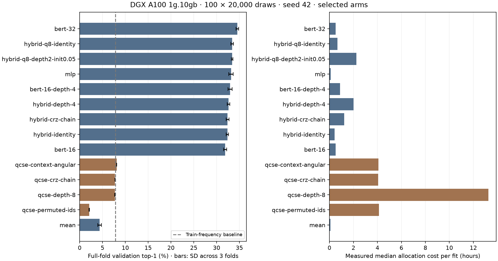
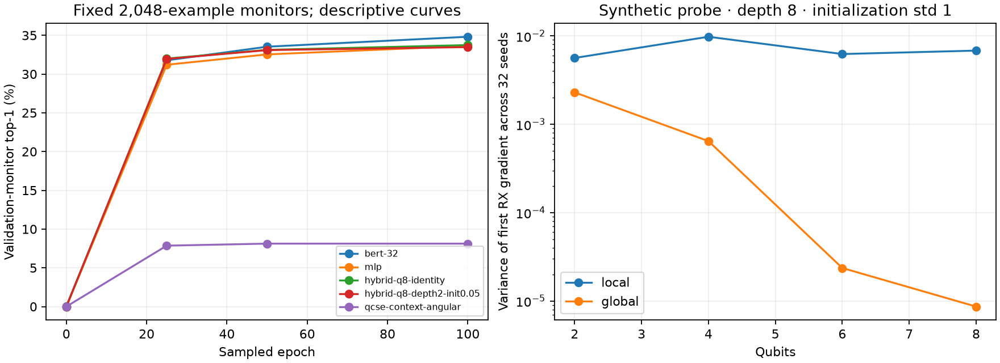

# Completed 156-fit causal screen — 2026-10-16

The strongest tested model is width-32 BERT from scratch. The eight-qubit hybrid
identity control is as accurate as its trained CRZ circuit at much lower cost.
Deepening QCSE spends more compute without improving exact-word prediction.
These are development observations, not held-out results or a quantum advantage
claim. The next batch is specified in [BENCHMARK_FOLLOWUP.md](../../docs/archive/BENCHMARK_FOLLOWUP.md).

## Evidence and reproducibility

- Archive: `robust-screen-main-diagnostics.zip`, 5,334,959 bytes, 1,416 files.
  SHA-256: `fd178685acf8dcbb6e37e6e0eff727aa179d8fd19efb54179b484ddc59066405`.
- Study: `qcse-bert-20261011T180753Z-hjdrhswn`.
  Manifest: `9c6e04456c1db3d7857e5d62e398d4d5a343d5fe1c8e2e6f6361330c32fdb1ee`.
  All 31 recorded source hashes match Git commit `dd105d5`; its only declared
  untracked file was `test.sbatch`. Both source CSV hashes match local originals.
- Manifest/selection fingerprints and all included prepared JSON artifacts
  match. All 156 task identities, epoch/update/draw ledgers, candidate means/SDs,
  runtime and successful phase records were checked. Six parameter-free QCSE
  controls have zero epochs; 150 trainable fits have exactly 100 epochs.
- Independently reconstructed grouped splits from the saved sentences without
  materializing token windows. All per-fold training/evaluation counts and
  training-only frequency baselines agree with every result ledger. Each fold
  validates about 53,913 sentence groups / 422,000 token windows. See
  `reconstructed_folds` in [summary.json](summary.json).
- Binary prepared splits, per-example predictions and checkpoints were omitted
  from this small export. Their actual saved IDs, logits, ranks and bootstrap
  pairing were not independently rechecked here. The successful DGX `select`
  already validated saved prediction alignment, ranks, metrics and budgets.
  Keep the original binaries on DGX for replication and final inference.
- No refit/test results are present. The five proposed refits in `selection.json`
  were only a selection plan. The identity/circuit comparison needs both arms
  retained explicitly in the next experiment.

The durable audit is `scripts/audit_benchmark_screen.py`: run it on the extracted
study with `--archive PATH --output results/robust-screen-main` from the repository.
It reads data only and verifies the original source through Git. Regenerate the
figures with `scripts/plot_benchmark_screen.py results/robust-screen-main`.
[All 52 arms](all-arms.csv), [156 fit records](cv-fits.csv),
[157 study-only allocations](accounting.psv), [synthetic probe](synthetic-probe.json)
and [machine-readable audit](summary.json) accompany this report.

## Protocol and fairness

Both full curated sources, 202,172 deduplicated sentences and a 10,864-word
vocabulary; causal next-word prediction with up to four preceding words.
The grouped split holds out 20% of sentences and uses exhaustive three-fold CV
inside the remaining 80%: approximately 53.33/26.67/20 train/validation/test.
Seed 42 is shared across arms. Trainable fits use 100 × 20,000 replacement draws,
batch 64, microbatch 8, 31,300 Adam updates and final-state scoring. Total training
exposure is 300 million draws / 4,695,000 updates. Two million draws correspond to
about 2.37 training-pool sizes per fit, not 100 full corpus passes.

All final validation folds are scored exhaustively. Curves instead use fixed
2,048-example monitors; their numbers differ from final full-fold scores. Means
below weight the three folds equally; SD is descriptive across correlated folds,
not a confidence interval. One initialization seed cannot establish robustness.
Selection across 52 arms also creates selection bias, so no significance test or
bootstrap interval is manufactured from these three aggregate observations.

All models see the same words, targets, partitions and update/exposure budget.
This is not parameter-, FLOP- or wall-time-matched: QCSE has 82 parameters,
MLP about 187k, and BERT-32 about 385k. BERT is the actual randomly initialized
MLM architecture on shared word IDs, without WordPiece, external pretraining or
original BERT corruption/NSP. The causal task is a controlled adaptation. The
next batch adds a near-capacity width-32 MLP and a separate bidirectional task.
The width-32 MLP has 368,880 parameters versus BERT's 385,394, a 4.3% difference.
Their default architecture-specific initializations/dropout remain distinct;
this is a tuned-budget comparison of specified implementations. Within the q8
circuit controls, shared encoder/head weights initialize identically at fixed
depth. Across the old depth variants the inherited initialization consumes a
different RNG sequence before the decoder, so depth is not the only changed
initial condition. The next paired circuit experiment fixes depth at two.
Exact sentences are grouped, but topics, sources and semantic near-duplicates
are not independently held out. This is not an out-of-domain semantics test.

Vocabulary and frequency-ranked IDs were built from both complete sources
before cleaning and splitting, as required by this project. This is a declared
transductive vocabulary/ID protocol, not strictly train-only preprocessing.
QCSE can exploit frequency rank geometrically. A future train-only-vocabulary
experiment would be a separate protocol, with explicit unknown-token handling.

## Accuracy and cost

The training-frequency baseline averages **7.8599% top-1, 21.6168% top-5 and
NLL 5.4521**. Top-1 and NLL can disagree; neither replaces the other.

| Configuration | Top-1 % | Fold SD (pp) | Top-5 % | NLL | Parameters | Median hours |
| --- | ---: | ---: | ---: | ---: | ---: | ---: |
| `bert-32` | 34.537 | 0.283 | 60.027 | 3.299 | 385,394 | 0.521 |
| `hybrid-q8-identity` | 33.416 | 0.298 | 58.041 | 3.482 | 186,144 | 0.657 |
| `hybrid-q8-depth2-init0.05` | 33.400 | 0.159 | 57.911 | 3.478 | 186,190 | 2.239 |
| `mlp` | 33.174 | 0.474 | 58.560 | 3.443 | 187,312 | 0.097 |
| `bert-16` | 31.878 | 0.315 | 56.606 | 3.517 | 191,730 | 0.517 |
| `hybrid-crz-chain` | 32.411 | 0.298 | 56.886 | 3.551 | 185,454 | 1.239 |
| `hybrid-identity` | 32.369 | 0.254 | 56.757 | 3.554 | 185,432 | 0.421 |
| `qcse-context-angular` | 8.099 | 0.044 | 20.375 | 5.718 | 82 | 4.086 |
| `qcse-crz-chain` | 7.740 | 0.047 | 20.265 | 5.721 | 82 | 4.058 |
| `qcse-depth-8` | 7.713 | 0.066 | 20.312 | 5.707 | 328 | 13.249 |
| `qcse-permuted-ids` | 2.093 | 0.043 | 11.971 | 5.979 | 82 | 4.129 |
| `mean` | 4.344 | 0.399 | 31.776 | 4.908 | 184,704 | 0.084 |

- BERT-32 exceeds MLP-16 by **1.3633 percentage points**, positive in all three
  folds (+1.079, +0.918, +2.093). It also has lower NLL, but about twice the
  parameters and 5.35× the median cost. Width-16 BERT loses to MLP; this changes
  the earlier small-BERT ranking and motivates equal LR tuning at width 32.
- Eight-qubit CRZ minus its identity control is **−0.0162 pp**, with fold
  differences −0.2075, +0.1975, −0.0386. CRZ costs **3.41×** as much and has
  slightly lower NLL (3.478 vs 3.482). Neither metric supports a reliable
  circuit improvement yet. Four-qubit CRZ gains only +0.0426 pp over identity,
  with mixed signs. Different questions require these paired controls.
- Increasing identity latent size from four to eight improves top-1 by about
  1.05 pp. This also doubles the encoder/output feature bottleneck. It does
  not demonstrate a useful exponential quantum state space: the identity
  features have an exact classical trigonometric implementation.
- QCSE angular context improves over its original context by **+0.3583 pp**
  in every fold, but reaches only +0.2398 pp above the frequency baseline;
  NLL and top-5 remain worse than that baseline. Frequency-ID permutation
  reduces top-1 to 2.093%, showing sensitivity to rank geometry, not semantic
  invariance. The diagonal context also performs poorly (3.409%).
- QCSE depth 8 costs about 13.25 hours/fit versus 4.06 at depth 2 and changes
  top-1 by −0.0274 pp. Its slightly better NLL is far from the frequency
  baseline. More depth is a low-priority allocation without a new mechanism.
- Mean pooling's low top-1 is not zero trainability: its embeddings/bias train,
  NLL improves to 4.908 and top-5 reaches 31.776%. Initialization and the
  information lost by unordered pooling are distinct candidate explanations.

## Optimization, plateau and Hamiltonian observations

QCSE's monitor largely stabilizes by epoch 25; BERT-32 and the learned hybrids
still improve between epochs 50 and 100. This does not justify shortening the
user's fixed training budget. It explains where additional architectural
research is more promising than repeating deep QCSE fits.

Active NLP circuit gradients remain measurable: the eight-qubit shallow/deep
hybrids have nonzero layer RMS gradients, zero recorded near-zero fractions in
the displayed final records and no clipping. QCSE has 27 exactly dead final
diagonal parameters under Z-only readout; the active parameters still have
nonzero gradients. Structural zeros, slow optimization and a barren plateau
must be distinguished. These data do not establish an NLP barren plateau.

The independent 32-seed synthetic probe does show cost dependence: at depth 8,
initialization std 1, first-RX variance is about 0.00563 → 0.00682 for the local
cost from two to eight qubits, but 0.00230 → 0.00000863 for the global cost.
Inputs, cost, register size and depth are specified in the saved probe. This is
consistent with a possible global-cost concentration mechanism, not a diagnosis
of our learned NLP objective or proof that these circuits form 2-designs.
[McClean et al.](https://arxiv.org/abs/1803.11173) and
[Cerezo et al.](https://arxiv.org/abs/2001.00550) establish barren-plateau results
under specified circuit/cost assumptions; those assumptions cannot be imported
solely because an accuracy curve flattens.
The next pilots add actual train-fold CE initialization-gradient variance at
2/4/8/12 qubits with a fixed encoder/head per size. Only a small toy check has
run locally; production NLP probe results await those CUDA pilots.

CRZ, ZZ and XX are gate-generator choices under a word-prediction loss. This
screen did not learn a semantic Hamiltonian or minimize graph/Laplacian energy.
The four-qubit generator comparison does not settle the eight-qubit question;
new XX/ZZ controls test that size without a broad depth sweep. A data-derived
Hermitian graph Hamiltonian, normalization/time choice and held-out graph
construction remain separate research/design work. See
[BENCHMARK_RESEARCH.md](../../docs/archive/BENCHMARK_RESEARCH.md).

For the identity hybrid, each qubit is RZ(b) RY(a)|0>, so its XYZ moments are
`(sin(a) cos(b), sin(a) sin(b), cos(a))`. The whole readout can be computed in
O(q), without a 2^q statevector. A bounded, one-thread CPU check at q=2/4/8
matches logits and every parameter gradient to float64 tolerance 1e-12; the
recorded maximum errors are below 4e-16. The q=8 tiny forward/backward benchmark
is about 11.3× faster in the recorded clean-snapshot check,
**not a measured DGX or full-vocabulary speedup**. See
[CPU evidence](identity-readout-cpu.json) and `scripts/profile_identity_readout.py`.
The next CUDA pilot must measure the optimized implementation. The relationship
to trigonometric feature maps is also motivated by
[Schuld, Sweke and Meyer](https://arxiv.org/abs/2008.08605); our identity formula
itself follows directly from the product state, not from a universality claim.

A local-only circuit is another useful control: one-qubit unitaries rotate each
XYZ vector by a 3×3 real rotation. The following unrestricted linear decoder can
absorb the block-diagonal rotation, `W R f(x) + b = W' f(x) + b`. Thus this
local-only hybrid has the same function class as the identity feature model;
its training trajectory/conditioning can still differ. Entangling gates may
change the feature class, but that alone does not establish useful NLP gains.

## Compute calibration

Pilot `9312_0` and array `9331_0..155` all completed with exit 0:0. Peak concurrent
allocations were **four**. The CV array ran from **2026-10-12 00:28:11 to
2026-10-15 22:47:44 in Slurm's reported local timestamps**: **94h 19m 33s**.
Its allocations sum to 366.492 job-hours, including the short reused task 0.
The longest fit was QCSE depth 8 at **13.522 hours**, within the requested 24-hour
limit. No failed allocation or timeout appears in this study's ledgers.

The original all-fit profile projection was 350.980 job-hours. Actual per-fit
allocation costs, after subtracting pilot calibration and skipping reused task
0, total **370.506 job-hours**, **5.56% above** that projection. The 93.145-hour
pilot-plus-CV forecast is not directly comparable with the array-only 94.326:
its scope includes a serial pilot. Excluding calibration/handoff, the observed
serial pilot plus array is about 98.35 hours, again approximately 5.6% longer.
Future pilots use an explicit **1.10 engineering planning factor**, not a
confidence bound or a fabricated GPU speedup.

Peak CUDA reservation across these fits was **456 MiB** against about 9.5 GiB
usable per MIG. Memory capacity is not the immediate limit. A larger microbatch
is a profiling candidate, but it changes BERT dropout draws and can alter
optimization/numerics. The next protocol keeps microbatch 8 and optimizer batch
64; the tested analytic identity path is the current optimization.

## Hypotheses and decisions

| Hypothesis | Evidence so far | Main alternative | Next discriminating experiment |
| --- | --- | --- | --- |
| Width/feature bottleneck matters more than trainable entanglers here | BERT-32 and q8 identity improve; q8 CRZ matches identity | Initialization or LR effects | Equal three-LR grids, fresh seed, matched q8 encoder/head, near-capacity MLP-32 |
| Poor QCSE is primarily representation/decoding limited | ID permutation collapse, weak NLL, depth adds cost, active gradients | A better objective/optimizer could help | Retain angular QCSE as a reference; research a genuinely changed encoding/readout before deeper sweeps |
| Bidirectional information may change model rankings | Current screen is causal only | Larger BERT simply has more parameters | Separate CBOW objective with identical inputs per model, same LR budget, MLP-32 and circuit controls |
| Mean initialization contributes to poor top-1 | Unordered tied lookup has poor top-1 but improving NLL | Information loss dominates | Small-std embedding mean control; exploratory, not a fully tuned mean-pooling verdict |
| Global-cost gradient concentration can occur | Synthetic global variance declines strongly, local does not | Probe-specific saturation/cost structure | Preserve raw probe scope; new NLP seed variance/Hessian study only if actual NLP gradients justify it |

The [next-batch protocol](../../docs/archive/BENCHMARK_FOLLOWUP.md) fixes budgets, LR selection,
primary contrasts, retained controls, confidence levels and source provenance
before any held-out scoring. Use seed 43 for refinement and 44/45/46 for the
small confirmation set. Bootstrap complete sentence groups, preserving seed
pairing and token weighting; overlapping windows are not independent samples.
This follows the task-specific statistical-design guidance of
[Dror et al.](https://aclanthology.org/P18-1128/). Three seeds and conditional
bootstrap intervals still do not establish out-of-domain performance or a
universal architecture ranking.
