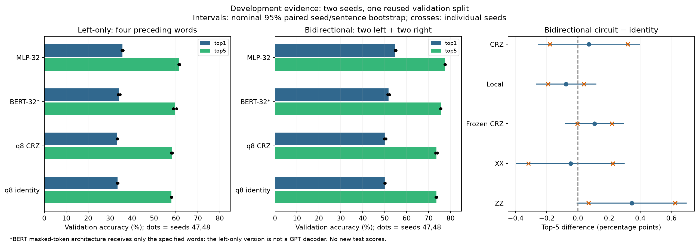

# Common-target controls: completed audit — 2026-10-21

Both left-only and bidirectional word prediction remain full research tracks.
The right-context intervention is one comparison, not a reason to stop studying
causal models. The next research protocol is in
[BENCHMARK_DUAL_TRACK_PLAN.md](../../BENCHMARK_DUAL_TRACK_PLAN.md); the project-wide
evidence inventory is in [PROJECT_RESEARCH_REVIEW.md](../../PROJECT_RESEARCH_REVIEW.md).

## Provenance and independent checks

Received `target-controls-20261021T015800Z-ij4_p682-diagnostics.zip`, 13,744,846
bytes, SHA-256
`a31b0c8b6e1765df8a3022c1ce94441e921fb891baaac917c5439433acf6efa4`.
All 427 entries are regular safe relative paths and the ZIP CRC check passes.
The compact export contains 426 hash-listed files plus its export manifest.

The data-only auditor verifies every listed hash, all 102 frozen source copies
against `483bea6`, and all six copied-tool instances against `555739e`. It
rebuilds the original grouped 20% outer split and five-fold development fold0
from saved sentence texts, not the omitted prepared arrays. All four split
target hashes agree with all three derived manifests. Local source CSV hashes,
the complete tokenized sentence list and vocabulary also match this export.

All 32 completed ledgers, runtime records, histories, exported sentence sums,
rank-count totals and job-wrapper records agree. Each fit used 100 epochs,
20,000 replacement draws per epoch, optimizer batch64/microbatch8, LR0.003,
31,300 updates, final-state selection and complete validation. All 101 monitor
rows have 2,048 examples; these curves are distinct from the final 252,120-target
evaluation. Total: 64M training draws and 1,001,600 optimizer updates.

There are 129,390 training groups / 1,014,085 eligible targets and 32,348
validation groups / 252,120 targets. All positions are positive. The already
observed outer test population is not rescored. This is one reused validation
fold with two new training seeds, 47 and 48, not a new independent test.

The export intentionally omits 99 prepared-array/prediction/checkpoint files.
The DGX exporter checked raw token predictions; this local audit independently
checks aggregates and rank-count consistency. It cannot recompute individual
token rankings, logits or actual training draw streams from this ZIP. Retain
the raw DGX artifacts for subsequent frequency/source/calibration analyses.

## Findings in each track



[All mean scores and timings](scores.md), [32 individual fit records](fits.csv),
[machine-readable audit, intervals and histories summary](audit.json).

- **Left-only L4:** MLP top-1 35.656%, top-5 61.463%; BERT-architecture reference
  34.084% / 59.546%; CRZ 33.316% / 58.119%; identity 33.357% / 57.942%.
  CRZ-minus-identity top-5 is +0.177 percentage points, with seed effects
  +0.109 and +0.245. Nominal paired 95% interval [+0.037,+0.320] pp. Top-1
  is -0.040 pp with mixed seed signs, and the NLL interval crosses zero.
  This is a small exploratory top-5 signal worth retaining in the causal track.
- **Bidirectional L2R2:** MLP top-1 54.893%, top-5 77.452%; BERT 51.722% /
  75.553%; CRZ 50.235% / 73.597%; identity 50.032% / 73.526%.
  CRZ-minus-identity top-5 is +0.071 pp with seed effects -0.179,+0.320;
  nominal interval [-0.253,+0.396] pp. NLL improves by 0.00949, in both seeds;
  better probability quality need not change the top-five ranking.
- **Mechanism controls, currently bidirectional only:** trainable CRZ does not
  reliably beat frozen CRZ. Local rotations and XX show mixed seed effects.
  ZZ-minus-identity is +0.346 pp top-1 and +0.347 pp top-5; both seeds favor
  ZZ, but the top-5 nominal interval is [-0.005,+0.695] pp and many contrasts
  were examined. ZZ is a candidate, not a confirmed improvement or evidence
  for a semantic graph Hamiltonian. The missing corresponding L4 controls
  must be run before making task-specific mechanism claims.
- **Information control:** L2R2 versus L2pad holds target composition, training
  pool and slot/mask placement fixed. Top-1 increases by 17.71–20.98 pp across
  the four models; top-5 by 16.05–17.52 pp. This establishes a right-information
  benefit under this recipe. It does not rank causal versus bidirectional
  modeling as research directions. L4 versus L2R2 also exchanges two left
  words for right words and is a different intervention.

MLP wins NLL/top-1/top-5 in each recipe and both seeds. Its 368,880 parameters
are near the BERT reference's 385,394, but the hybrid has a different capacity;
this is not exact parameter/FLOP matching or proof of an architecture's best
tuned performance. Fixed LR0.003 comes from earlier development, not independent
retuning of these changed tasks. The causal reference is `BertForMaskedLM`
with the target mask appended to left context: no future input is supplied,
but its internal context attention is bidirectional. It is not a GPT decoder.

## Robustness and convergence

The audit uses 10,000 paired seed/sentence bootstrap draws, shared across
recipes and models, and reports sentence-only intervals, both per-seed effects
and sentence-macro effects. Only two fitted seeds are available: resampling
their pair gives just three distinct seed-weight combinations. Narrow sentence
intervals cannot establish training-seed robustness. All intervals are nominal
development summaries without family-wise correction, not confirmatory tests,
equivalence bounds or new-population generalization intervals. Full per-seed
numbers remain in the audit, including negative effects.

Every model/recipe mean monitor NLL improves between epochs 50 and 100, by
0.0525–0.1559. Mean sampled top-5 rises 0.59–3.10 pp. These 2,048-target curves
justify a small prospective longer-budget convergence study in both tracks;
they do not establish convergence at 100 or select a best epoch. Full validation
was evaluated only at the final epoch, so earlier full scores cannot be inferred.

Trainable circuits have nonzero epoch-aggregated layer gradients throughout
these fits; the smallest recorded layer RMS is about 0.0149. Clipping is rare.
This is consistent with ongoing learning at q8, not evidence that increasing
qubit count is harmless or a new barren-plateau scaling test. Initializer
variance, mean gradient, trained gradient and optimizer update size differ.

## Compute and useful optimization

| Array | Fits | Recorded wrapper MIG-hours | Wrapper span hours | Peak overlap |
| --- | ---: | ---: | ---: | ---: |
| 10335: L4 | 8 | 5.904 | 2.325 | 4 |
| 10346: L2pad | 8 | 5.976 | 2.365 | 4 |
| 10356: L2R2 | 16 | 21.736 | 6.077 | 4 |

Combined wrapper span: **10h46m50s**, 33.616 MIG-hours; fresh-profile forecast:
12.040 sequential-array hours / 37.302 MIG-hours. Recorded costs are about 10%
below the margin-bearing forecast. These are fit-job wrapper records, not
`sacct` allocation totals; profile job 10334, queue time and packaging are outside
the measured scope. Global observed wrapper overlap is four, each requesting
one `nvidia_a100_1g.10gb` instance.

MLP takes about 5.4–5.5min, BERT30min, identity7.2min, CRZ133–138min per fit.
Bidirectional local/frozen each take96min, XX144min and ZZ133min. Reported peak
Torch CUDA reserved memory is90.2MB; this excludes non-Torch/context allocations
and is not total GPU usage. The most useful optimization pilot is microbatch
8/16/32/64 at unchanged Adam batch64, on one actual MIG. Verify losses,
gradients, accumulated updates and peak device memory before choosing a size.
Dropout/RNG and reduction order can change trajectories; smaller kernel-launch
overhead is a hypothesis requiring measurement, not a promised speedup.

## Reproduce the local analysis

Extract the archive under ignored `outputs/target-controls-review/archive/`,
then from the repository root:

```bash
OMP_NUM_THREADS=1 OPENBLAS_NUM_THREADS=1 VECLIB_MAXIMUM_THREADS=1 \
  MKL_NUM_THREADS=1 .venv/bin/python scripts/audit_target_controls.py \
  outputs/target-controls-review/archive/target-controls-20261021T015800Z-ij4_p682 \
  --output results/robust-target-controls --draws 10000 --check-local-corpus
OMP_NUM_THREADS=1 OPENBLAS_NUM_THREADS=1 VECLIB_MAXIMUM_THREADS=1 \
  MPLCONFIGDIR=/tmp/qcse-matplotlib .venv/bin/python scripts/plot_target_controls.py
```

No local model training or new DGX job was run for this analysis.

Focused final verification: **10 tests passed in2.11s**, one CPU thread;
Ruff passes and Pyright reports zero errors/warnings for the new scripts/tests.
Tests cover split/target reconstruction, paired resampling with unequal
sentence lengths, seed versus sentence averaging, simultaneous job boundaries,
tampered export rejection, and actual fixed-code decoder probability/gradient
equivalence. The complete real-export audit and local corpus reconstruction
pass; the generated figure was visually inspected. No new CUDA/Slurm execution
is claimed by these local checks.
