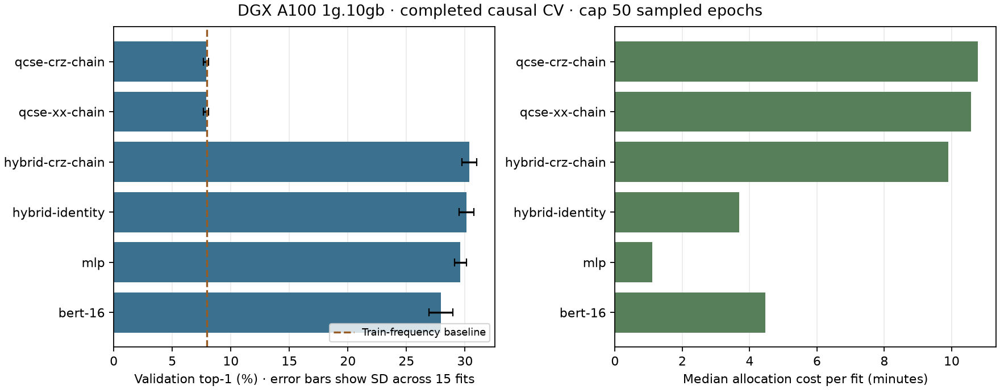

# DGX measured CV review — 2026-10-11

All 90 CV fits completed successfully. The hybrid circuit has almost the same
validation accuracy as its identity control, at substantially higher cost.
Paper-style QCSE does not beat the train-frequency baseline in this study.
These are development results; held-out refits are absent from this export.

## Evidence and validation

Study: `qcse-bert-20261011T134017Z-xi2j1msr`, source commit `18d4ef6`.
Archive SHA256: `f3dfd0e057ae8d9cb0cd3b84d1a2c1b71da26f747d5fc5543b6709a276838f01`.
Manifest: `741dad170e741f77be2e16787140b0ce518f8901a9f53cf0b544d672d91d2c1b`.

Read the supplied diagnostics ZIP without executing its contents. Verified both
manifest/selection fingerprints, all 30 recorded source hashes against the Git
commit, and the three included prepared JSON artifact hashes. Each of the 90
results matches its task/fingerprint, its epoch/update/draw ledger, complete
history and complete phase record. Recomputed all six candidate means and sample
standard deviations and cross-checked the CSV durations against job accounting.
All 91 study allocations (pilot plus array) are `COMPLETED`, exit `0:0`, with
successful preflight subprocess return codes. Hardware metadata identifies
CUDA and A100-SXM4-80GB MIG `1g.10gb`, four Torch threads.

The only source dirt recorded on DGX is untracked `test.sbatch`. Recorded source
bytes match the commit. Unrelated local working-tree model edits were not used.
The archive omits `causal.npz`, per-example `predictions.npz`, checkpoints and
the source directory. Consequently this review cannot independently recompute
prediction aggregates, split isolation, held-out scores or sentence-bootstrap
intervals. Successful DGX `select` reports validation of those binary artifacts
by the source's existing validator; it does not replace an independent export
audit of them. No new training or GPU job was run during this review.

## Dataset, split and iterations

Both complete active sources, `phrases.csv` and `cleaned_sentences.csv`, produced
202,172 deduplicated sentences. `tatoeba.csv` is excluded. Vocabulary has 10,864
words and is shared, built from both complete sources before cleaning/splitting.
This is a declared transductive vocabulary, rather than train-only vocabulary.

Sentence groups have an 80/20 development/test split, seed 2026. Five exhaustive
development folds give approximately 64/16/20 train/validation/test fractions
of groups. Each arm uses seeds 42, 43, 44. The causal target sees up to four
previous words. Test data does not participate in configuration selection.

The cap was 50 sampled epochs, each with 5,000 replacement draws from the entire
eligible training pool, batch 64, microbatch 8: 79 Adam updates per epoch.
This is not 50 full-corpus passes. Patience eight/minimum ten epochs permits
shorter fits; scores use the validation-selected trained checkpoint. Monitoring
uses 2,048 examples; final CV scoring uses 2,000 complete sentence groups per
fold (roughly 15,000 target words), rather than the whole validation fold.
Actual totals: **16,575,000 draws and 261,885 optimizer updates**.

## Results

Each row aggregates 15 fits. SD describes fold/seed dispersion, not a confidence
interval. Repeated seeds share validation data, and fold training sets overlap.

| Model | Top-1 % ± SD | Top-5 % | NLL | Parameters | Median stopped epochs | Median allocation minutes |
| --- | ---: | ---: | ---: | ---: | ---: | ---: |
| QCSE CRZ | 7.890 ± 0.210 | 19.747 | 6.292 | 82 | 15 | 10.78 |
| QCSE XX | 7.884 ± 0.206 | 20.426 | 6.086 | 82 | 14 | 10.57 |
| Hybrid CRZ | 30.369 ± 0.643 | 53.668 | 3.757 | 185,454 | 50 | 9.90 |
| Hybrid identity | 30.136 ± 0.619 | 53.649 | 3.756 | 185,432 | 50 | 3.68 |
| MLP | 29.610 ± 0.501 | 51.791 | 3.951 | 187,312 | 50 | 1.10 |
| BERT width 16 | 27.948 ± 1.007 | 50.332 | 3.903 | 191,730 | 50 | 4.47 |

The shared train-frequency baseline is **7.964% top-1, NLL 5.439**. Both QCSE
variants underperform it on average top-1 and NLL. They have 14 qubits, while
the hybrid uses a learned encoder and four latent qubits; this is not a
parameter-matched comparison between those architectures.

Hybrid CRZ improves top-1 over identity by **0.233 percentage points** and costs
**2.69×** as much per median allocation. It wins 9/15 paired fold/seed comparisons,
but fold-average differences are `+0.272, +1.314, -0.034, -0.066, -0.321` points.
NLL is slightly worse. This evidence does not establish a reliable circuit
benefit. Identity retains the nonlinear quantum-state encoder/readout, so it is
specifically a variational-circuit ablation, not a completely classical model.
Matching seeds also does not guarantee identical downstream weight draws when
one architecture consumes additional random numbers during initialization.

MLP beats this BERT configuration by **1.662 points**, in all 15 pairs, at about
one quarter of its median allocation cost. This BERT is a small random-initialized
backbone trained on the shared word vocabulary/prefix objective; it is not
pretrained BERT. Different learning rates, widths, depths and a matching
bidirectional task are needed before generalizing an architecture ranking.
[The original BERT paper](https://arxiv.org/abs/1810.04805) studies pretrained
bidirectional representations and downstream transfer, a different setting.

## Compute and optimization

Array `9216` ran from 15:54:24 to 18:25:20 in Slurm-local time: **2:30:56**.
Its 90 allocations used **9.9525 job-hours**, including the reused task's
preflight/validation. The preceding pilot `9215_0` also completed. Accounting
intervals for these allocations never exceed **four simultaneous instances**.
The exported accounting also contains earlier study jobs, which were filtered
out; `.batch`/`.extern` steps were not counted again. The longest array task is
**18:14**, far below the 12-hour per-job limit. This batch did not time out.

The archived timing report forecasts the same 90-fit early-stopping protocol at
2.55 hours from arm medians or 2.98 hours from arm P90s, close to the observed
2.52-hour array. Those forecasts exclude pilot handoff/calibration and refits;
they are not bounds. Its 50-epoch-cap scenario is 5.46 hours, an extrapolation.

Median training seconds per 5,000-draw epoch are approximately 32.60/34.73 for
QCSE CRZ/XX, 10.09 for hybrid CRZ, 3.42 for identity, 0.69 for MLP and 4.16 for
BERT. Checkpoint I/O is small. About 19–20 seconds per allocation is outside fit
timing, so startup/preflights matter especially for the one-minute MLP runs.
GPU peak reserved memory is at most **208 MiB** across the six arms, versus
about 9.5 GiB usable capacity. A larger simulation microbatch is a reasonable
profiling candidate, but available memory alone does not prove a speedup.
Changing BERT microbatching can also change dropout draws. Keep optimizer batch
64 and use fresh provenance if changing the microbatch.

For the same six arms/5 folds/3 seeds, extending to 100 × 20,000 draws projects
approximately **40 hours for pilot plus CV, then five hours for 12 same-winner
refits**, before queue waits. That provisional phase extrapolation still used
2,000-group final scoring. The new screening protocol below reduces repetition
and increases final scoring to the whole fold; it needs its own estimates.
Unseen ansatzes, qubit counts, depth/width and datasets cannot inherit these
measured costs as if benchmarked. New pilot profiles export per-arm estimates.

## Plateau diagnosis and research

QCSE CRZ active layer RMS gradients range approximately **0.026–0.234** and XX
**0.025–0.139** across epoch summaries; no optimizer batch is gradient-clipped.
The CRZ Z-readout has **27 structurally dead parameters out of 82**. XX has none,
yet performs similarly poorly. The hybrid's RMS gradients are **0.016–0.078**;
its epoch-average clipping fraction is about 0.59%. Thus tiny global gradients
are not the observed explanation for this accuracy plateau. An encoding/decoder
bottleneck or objective/initialization issue is a hypothesis to test, not a
diagnosis established by these aggregates.

[McClean et al.](https://arxiv.org/abs/1803.11173) identify barren plateaus through
gradient concentration that worsens exponentially with qubit count under their
random-circuit conditions. A fixed-qubit NLP learning curve cannot establish
that scaling. [Cerezo et al.](https://arxiv.org/abs/2001.00550) show that cost
locality and depth matter under specified circuit assumptions; their theorem
does not automatically cover this learned word-loss architecture.
[Grant et al.](https://arxiv.org/abs/1903.05076) use exact identity-block
initialization. Our small Gaussian initialization is not that construction.

The next screen varies 2/4/8 latent qubits, depth 2/8, and initialization
0.05/1.0, with identity controls at each size. Compare gradient traces as well
as accuracy, memory and time. Changing latent qubits also changes encoder/head
capacity. The separate existing synthetic gradient-variance probe helps isolate
the mechanism; neither analysis supports a claim of quantum advantage.

## Next work

Use [the staged long-budget plan](../../BENCHMARK_SCREEN.md): three folds/one
seed for discovery, then a small prespecified five-fold/three-seed confirmation
set. Screen without inspecting held-out results. Retain a matched identity
control in the confirmation refits; the old family-winner-only selection would
drop it. Use full final validation/test scoring and retain per-example artifacts
for independent split/prediction auditing and paired sentence-bootstrap intervals.

XX/ZZ/CRZ generator ablations are available. Graph/Laplacian semantic
Hamiltonians remain research proposals: this implementation does not optimize
their energy or supply a validated semantic graph model. Fresh CUDA profiling,
long-run verification, confirmation and held-out refits remain to run on DGX.

Machine-readable evidence: [summary.json](summary.json), [cv-fits.csv](cv-fits.csv)
and study-only [accounting.psv](accounting.psv). Full diagnostics remain in local
ignored `outputs/dgx-timed-review/`; conversation exports stay local.
